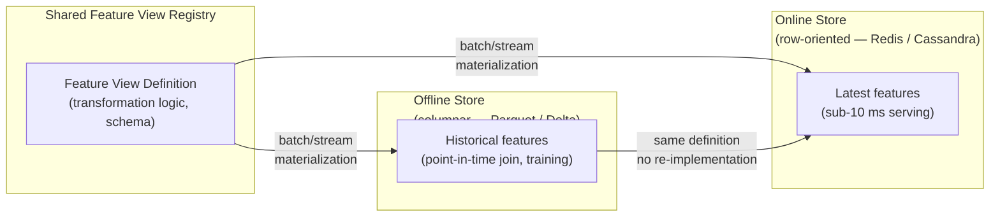
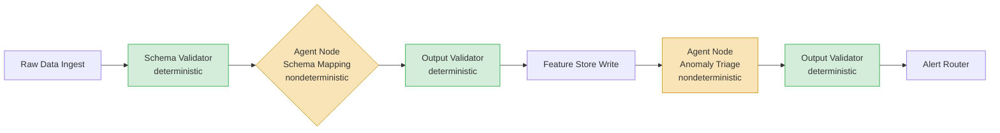

# Data Engineering in the Age of AI

**Data Preparation for ML, AI Agents in Pipeline Automation, and Vector Databases**

Lecture 7 · Graduate Data Engineering

<!-- Speaker: Welcome the class and frame the scope — this lecture connects the pipeline skills they already have to the additional correctness, versioning, and architectural demands that ML and AI systems impose. -->

<!-- Notes:
This title slide sets up a lecture that spans three large, interconnected themes: preparing data correctly for ML (training/serving skew, feature stores, reproducibility, quality), using vector databases and embeddings as first-class pipeline stages, and deploying AI agents as components in automated pipelines. Students come in with solid SQL, Python, and Spark skills; the goal is to show them where those skills are necessary but no longer sufficient. The framing is deliberately practical — every section pairs a conceptual failure mode with a concrete engineering remedy.
-->

---

## Agenda

- **(A) Why ML Changes Everything** — how ML pipelines differ from BI pipelines and why silent failure is the default
- **(B) Training/Serving Skew** — the central ML-data failure mode and its two root causes
- **(C) Feature Stores & Point-in-Time Joins** — the mechanism that eliminates temporal leakage
- **(D) Reproducibility** — versioning data, datasets, and embedding models as a three-layer temporal problem
- **(E) Data Quality & Observability for ML** — schema drift, distribution drift, concept drift, and layered monitoring
- **(F) Embeddings as a Pipeline Stage** — model selection, batching, idempotency, and version coupling
- **(G) Vector Databases** — ANN index families, recall as an SLO, and metadata filtering
- **(H) RAG as a Two-Stage Pipeline** — chunking, hybrid retrieval, reranking, and recall ceilings
- **(I) AI Agents in Pipeline Automation** — where agents earn their place, failure modes, and architectural constraints
- **(J) Governance, Privacy & Evaluation** — GDPR obligations, lineage, security surfaces, and cost-aware evaluation

<!-- Speaker: Read through the ten sections briefly and note the arc: correctness problems first, then storage and search, then automation, then governance. Tell students the sections build on each other — skew in B motivates feature stores in C, which motivates reproducibility in D. -->

<!-- Notes:
The agenda slide doubles as a cognitive map for the 90-minute lecture. Sections A–E address the correctness and quality demands that ML imposes on data pipelines — problems that do not exist or are less severe in pure BI contexts. Sections F–H introduce the embedding and vector retrieval stack as a new, version-sensitive pipeline stage that most data engineers will encounter when their organization adopts RAG or semantic search. Section I examines AI agents as pipeline components, distinguishing the narrow, bounded use cases where agents add value from the open-ended tasks where they accumulate costs and failures. Section J closes with governance and evaluation — the operational and compliance layer that wraps the entire stack. Instructors may choose to break the lecture at the end of section E for a short pause or Q&A before moving into the embedding and agent material.
-->

---

## The Silent Failure Problem

- ML systems fail silently: unlike traditional software that raises exceptions or dashboards that display visibly-wrong numbers, a model will continue returning predictions even when input data is incorrect or significantly shifted, producing low-quality outputs without raising any alarm. [claim:agde:001]

<!-- Speaker: Contrast this with a broken dashboard — the business at least knows something is wrong. With a silently degrading model, the damage accumulates invisibly before anyone notices. -->

<!-- Notes:
This slide sets the motivating problem for the entire lecture. The key insight is that the failure modes of ML systems are categorically different from those of traditional software. In a web service, an exception propagates and alerts an on-call engineer; in an ML system, the model simply returns a slightly worse number, and that degradation may take weeks or months to surface in business metrics. This asymmetry is what makes data engineering for ML a distinct discipline: correctness guarantees that would be implicit in software systems must be explicitly engineered into data pipelines. Students familiar with software engineering should appreciate that there is no stack trace for a model that has been trained on leaky features — only a slowly declining precision curve that is easy to miss.
-->

---

## The AI Hierarchy of Needs

- Monica Rogati's 'AI Hierarchy of Needs' (2017) frames AI as the top of a pyramid: before deploying ML, organizations must first have data literacy, collection, and infrastructure in place, just as Maslow's hierarchy requires food and shelter before self-actualization. [claim:agde:003]
- According to the CrowdFlower 2016 Data Science Survey, 80% of data scientists' work consists of data preparation: 60% of respondents spent most of their time cleaning and organizing data, and 19% spent most of their time collecting data sets. [claim:agde:004]

<!-- Speaker: The pyramid is not a metaphor — it is a budget allocation. The 80% figure from the survey makes that concrete: if your data infrastructure is broken, no amount of model sophistication will help. -->

<!-- Notes:
Monica Rogati's hierarchy of needs (published on HackerNoon in 2017) is a foundational framing for this course. The pyramid has five layers from bottom to top: data collection, data storage/flow, exploration/transformation, aggregates/features/labels, and finally AI/deep learning at the apex. The CrowdFlower statistic from 2016 remains widely cited and reinforces the same point: the bottleneck in AI projects is almost never the algorithm — it is the data pipeline underneath. For a graduate audience, it is worth noting that this survey predates the LLM era, yet the pattern persists: even organizations using GPT-4-class models spend the majority of their engineering effort on chunking, cleaning, deduplication, and feature preparation rather than on model selection. The pyramid also provides a natural structure for this lecture: sections A through E address the bottom four layers of the pyramid, and sections F through J address the transition to AI applications at the top.
-->

---

## BI vs. ML — A Different Contract on the Pipeline

- ML systems fail silently: unlike traditional software that raises exceptions or dashboards that display visibly-wrong numbers, a model will continue returning predictions even when input data is incorrect or significantly shifted, producing low-quality outputs without raising any alarm. [claim:agde:001]
- ML treats datasets as versioned, time-aware artifacts — immutable snapshots tied to a specific point in time — rather than as query targets, because ML reproducibility requires knowing exactly what data state produced a given model or index, a requirement absent in BI where the latest snapshot is always the correct answer. [claim:agde:005]

<!-- Speaker: BI asks "what is true now?"; ML asks "what was true when this label was created?" That question demands versioned, time-aware artifacts rather than a live query target. -->

<!-- Notes:
This slide draws the sharpest contrast between BI and ML data contracts. In a BI context, overwriting a dimension table with updated values is correct behavior — the dashboard should always reflect current state. In an ML context, that same overwrite is a data integrity violation: the features used to train the model no longer exist, so the experiment is not reproducible, and any point-in-time join performed after the update will silently pull in future state. Students who have worked in analytics engineering should be pushed to confront this directly: the tooling, patterns, and intuitions they bring from BI (e.g., SCD Type 1 overwrites, full table refreshes) are actively harmful in ML pipelines unless accompanied by explicit versioning discipline. The two bullets together set up both the silent failure framing and the reproducibility requirement that structures sections C and D of the lecture.
-->

---

## Data as a Versioned, Time-Aware Artifact

- ML treats datasets as versioned, time-aware artifacts — immutable snapshots tied to a specific point in time — rather than as query targets, because ML reproducibility requires knowing exactly what data state produced a given model or index, a requirement absent in BI where the latest snapshot is always the correct answer. [claim:agde:005]

<!-- Speaker: Immutability and audit trails for datasets are a first-class engineering requirement, not a nice-to-have. This framing will anchor the reproducibility section later in the lecture. -->

<!-- Notes:
This slide reinforces the versioning discipline introduced in the previous slide, giving it a standalone focus before the lecture dives into concrete mechanisms. The core principle is that every model artifact should be traceable back to a specific data snapshot: training data version → feature transformation version → model artifact. Without this chain, retraining a model is not reproducible — you may get a different model even if the algorithm and hyperparameters are identical, simply because the underlying data has changed. Treating datasets as immutable artifacts is the foundational commitment that makes the rest of the reproducibility machinery (Iceberg snapshots, DVC, lakeFS — covered in Section D) meaningful. A useful analogy for students: in software, pinning a dependency means pinning a content-addressable hash of the library; in ML, pinning a dataset means the same thing — a content-addressable pointer to an exact snapshot, not a mutable table name.
-->

---

## Feature Engineering as a Stateful Pipeline Stage

- Feature engineering is a stateful pipeline stage: transformation functions that normalize or encode features require statistics (means, standard deviations, vocabularies) computed solely on the training set ('fit-time statistics'), which must be stored and then reapplied identically during inference to prevent training-serving skew. [claim:agde:006]

<!-- Speaker: The fit-time statistics — means, vocabularies, quantile boundaries — computed during training must be stored and replayed identically at inference. This is where the state lives, and losing it is a direct path to skew. -->

<!-- Notes:
This slide introduces the concept of statefulness in feature engineering, which is subtle and often misunderstood by students coming from a pure SQL or analytics background. A StandardScaler is not a pure function: it computes μ and σ from the training data during fit(), stores them, and applies them during transform(). If you refit the scaler on new production data, you get different μ and σ, and the normalized values your model sees at inference are now on a different scale from what it was trained on — this is training-serving skew, even if the code paths are otherwise identical. The same pattern applies to one-hot encoders (vocabulary must be fixed at training time), quantile transformers (quantile boundaries must be fixed), and any other stateful transform. The stored statistics are the artifact that must be versioned alongside the model weights — they are part of the model's dependency graph. This sets up the code example on the next slide and the broader discussion of skew in Section B.
-->

---

## Stateful sklearn Pipeline — Fit vs. Transform

- Feature engineering is a stateful pipeline stage: transformation functions require fit-time statistics computed solely on training data, which must be stored and reapplied identically at inference to prevent training-serving skew. [claim:agde:006]

```python
import numpy as np
from sklearn.pipeline import Pipeline
from sklearn.preprocessing import StandardScaler
from sklearn.linear_model import LogisticRegression
import joblib

# --- TRAINING TIME ---
X_train = np.array([[1.0, 200.0],
                     [2.0, 400.0],
                     [3.0, 600.0]])
y_train = np.array([0, 0, 1])

pipeline = Pipeline([
    ("scaler", StandardScaler()),   # fit() computes mean & std from X_train
    ("clf",    LogisticRegression()),
])
pipeline.fit(X_train, y_train)

# Inspect stored fit-time statistics
scaler = pipeline.named_steps["scaler"]
print("mean:", scaler.mean_)    # [2.0, 400.0]
print("scale:", scaler.scale_)  # [0.816, 163.3]

# Persist the entire pipeline (scaler state + model weights)
joblib.dump(pipeline, "pipeline.joblib")

# --- INFERENCE TIME (production) ---
pipeline_loaded = joblib.load("pipeline.joblib")

X_prod = np.array([[2.5, 500.0]])

# CORRECT: reuse stored mean/std from training — transform() only, no fit()
prediction = pipeline_loaded.predict(X_prod)
print("prediction:", prediction)

# BUG: calling fit() on production data recomputes mean/std from X_prod
# — the scaler now uses X_prod statistics, not X_train statistics
# — this is training-serving skew
pipeline_loaded.named_steps["scaler"].fit(X_prod)  # DO NOT DO THIS
```
<!-- EXEC_TEST -->

<!-- Speaker: Make concrete that calling fit() on inference data is the canonical stateful-transformation mistake. The pipeline.joblib file carries the mean and std computed on training data — that is the artifact that must travel to production alongside the model weights. -->

<!-- Notes:
This code example is designed to make the abstract concept of stateful transformations tangible. The key pedagogical points to emphasize: (1) joblib.dump serializes not just the LogisticRegression coefficients but also the scaler's mean_ and scale_ attributes — these are the fit-time statistics; (2) at inference time, pipeline_loaded.predict() calls transform() on the scaler using the stored statistics, so the feature scaling is consistent with training; (3) the bug at the bottom — calling scaler.fit() on X_prod — resets the scaler's statistics to those of the production batch, which may have a completely different distribution. The model then receives inputs on a different scale from what it saw during training, producing incorrect predictions with no error raised. Students should understand that the joblib file is not optional infrastructure — it is a core part of the model artifact that must be versioned, tested, and deployed alongside the weights. In a feature store context, this serialized transform state would be stored in the feature view definition and applied consistently by the serving layer.
-->

---

## What Is Training/Serving Skew?

- Training-serving skew is defined as a discrepancy between ML model feature engineering or data handling during training versus during deployment (serving) [claim:agde:007]
- Google identifies it as a central ML production failure mode with three root causes: divergent data handling in training vs. serving pipelines, data change between training and serving, and feedback loops between model and algorithm [claim:agde:007]
- Skew is a silent killer: the model runs without errors and produces predictions, but those predictions are based on incorrect inputs and accuracy degrades without raising any alarm [claim:agde:002]
- Unlike data drift, which develops gradually after deployment, skew can exist from day one and go unnoticed [claim:agde:002]

<!-- Speaker: Open by contrasting with a broken dashboard — at least that fails visibly. Skew is insidious because the pipeline looks healthy while accuracy erodes from the first prediction onward. -->

<!-- Notes:
Google's Rules of Machine Learning (Rules 29, 31, 32) codifies training-serving skew as one of the most consequential ML production failure modes precisely because it is invisible at the infrastructure layer. A monitoring system that checks for exceptions, null rates, or pipeline DAG health will report green while every prediction is subtly wrong.

The three-root-cause taxonomy from Google is worth unpacking: (1) divergent code paths — training and serving re-implement the same transformation independently; (2) data change — the distribution of inputs shifts between when the model was trained and when it serves, which is distinct from the code-path problem; and (3) feedback loops — the model's own outputs influence future inputs (e.g., a recommendation model whose outputs become training data).

A critical nuance is that skew is not a temporal phenomenon in the way drift is. A model can have skew from the very first inference call, before it has been in production for even a second. This is the distinction between an engineering defect (present at deployment) and a temporal phenomenon (develops over time after deployment). That distinction drives different remediation strategies — you cannot fix skew by retraining on fresher data; you must fix the pipeline code.
-->

---

## Two Root Causes of Skew

- Divergent batch-training vs. online-inference code paths are a primary source of skew: when training and serving pipelines independently re-implement the same feature transformation, small differences in tokenization, string normalization, missing-value defaults, or floating-point rounding compound into a feature gap that silently degrades model performance [claim:agde:008]
- Point-in-time correctness violations are the second root cause: when feature generation, predictions, and label generation occur at different points in time, a naive join that does not constrain feature values to those available at the prediction timestamp incorporates future information, causing models to perform well in training but fail in production [claim:agde:009]

<!-- Speaker: Root cause 1 is a code-divergence problem — two teams, two languages, two implementations of the same logic. Root cause 2 is a time-travel problem — the training set accidentally sees the future. Both are engineering defects, not data problems. -->

<!-- Notes:
Root cause 1 (divergent code paths) is especially common at organizations where training is done in Python/scikit-learn and serving is done in Java or Go. Even when both pipelines are in Python, a training job that uses pandas and a serving endpoint that uses a different library can diverge on edge cases: how NaN is handled, how string whitespace is trimmed, or how categorical encodings are ordered. Google's Rule 32 — "reuse code between your training pipeline and your serving pipeline whenever possible" — is the direct remediation: a shared transformation library with a single code path eliminates this class of bug by construction.

Root cause 2 (point-in-time correctness) is more subtle and often more damaging. Consider a fraud detection model trained on a join of transactions to a customer dimension table. If the join uses the customer's current churn_flag or credit_tier rather than the value that existed at transaction time, the model learns from future information. This produces artificially high offline AUC scores — the model "knows" which customers will later churn — but those signals are absent at inference time, so the deployed model underperforms severely. This is the topic of slide 11.

Students often conflate these two root causes. It helps to separate them clearly: root cause 1 is about which code runs; root cause 2 is about which time window the data covers.
-->

---

## The Temporal Leak (Naive Join)

- A naive equi-join of a transactions table to a customer dimension table and timestamped labels — without constraining customer attributes to those that existed at or before the transaction timestamp — leaks future customer state into training rows, creating overly optimistic offline metrics that collapse at deployment [claim:agde:010]

```sql
-- Schema:
--   transactions(tx_id, customer_id, tx_ts, amount)
--   customer_dim(customer_id, churn_flag, credit_tier, updated_at)
--   labels(tx_id, is_fraud, labeled_at)

-- NAIVE JOIN — leaks future state:
-- customer_dim is joined without a time constraint,
-- so churn_flag and credit_tier reflect their value
-- as of query time, not as of tx_ts.
SELECT
    t.tx_id,
    t.customer_id,
    t.tx_ts,
    t.amount,
    c.churn_flag,      -- value as of NOW, not as of tx_ts
    c.credit_tier,     -- value as of NOW, not as of tx_ts
    l.is_fraud
FROM transactions t
JOIN customer_dim c
    ON t.customer_id = c.customer_id   -- no time constraint!
JOIN labels l
    ON t.tx_id = l.tx_id;
```
<!-- EXEC_TEST -->

<!-- Speaker: Walk through each table column by column. The bug is the JOIN on customer_dim with no WHERE or inequality on updated_at — it pulls the current row from the SCD, not the row that was current when the transaction occurred. -->

<!-- Notes:
This slide makes the temporal leak concrete with a schema students can reason about. The three tables represent a realistic fraud detection setup: transactional events, a slowly-changing dimension (SCD) table for customer attributes, and an external label table.

The critical point is that customer_dim is a slowly-changing dimension — customer attributes like churn_flag and credit_tier are updated over time. A customer who was not churned at the time of a transaction may have churned by the time the training query runs. The naive join attaches the post-churn flag to the pre-churn transaction, giving the model a signal that would not have been available at inference time.

The EXEC_TEST comment is included because this query is valid SQL against the stated schema and should be testable. In a teaching context, it is worth running both the naive version and the corrected point-in-time version (shown in slide 15) side-by-side on a small synthetic dataset to demonstrate the difference in training set distributions.

A common student question: "Doesn't the labels table also cause leakage?" Yes — labeled_at may be days or weeks after tx_ts. The label is correctly associated with the transaction, but any features derived from customer behavior between tx_ts and labeled_at would also constitute leakage. The fix for the label table is the same: time-constrain all dimension lookups to tx_ts, not to labeled_at.
-->

---

## Skew vs. Drift — Do Not Conflate Them

- Training-serving skew and concept/distribution drift are distinct failure modes: skew is a consistency mismatch between two code paths or between feature values used at training vs. serving time, present at the moment of deployment and requiring no time to manifest [claim:agde:011]
- Concept drift is formally defined as P(Y|X) changing while P(X) stays the same — the relationship between features and labels changes because the world changed; covariate shift is P(X) changing while P(Y|X) stays the same [claim:agde:012]
- Both drift types are temporal phenomena occurring after deployment; training-serving skew is an engineering defect present from day one [claim:agde:011]

<!-- Speaker: Stress that mixing these two up leads to wrong remediation: you cannot fix skew by retraining on fresher data, and you cannot fix drift by unifying your code paths. They require different interventions. -->

<!-- Notes:
This distinction is one of the most frequently confused concepts in ML operations. The decomposition P(X,Y) = P(X) · P(Y|X) is the formal basis for distinguishing the two drift types: covariate shift affects P(X) (the marginal input distribution), while concept drift affects P(Y|X) (the conditional relationship between inputs and outputs).

Training-serving skew sits in a different category entirely — it is not a statistical phenomenon at all. It is an engineering defect: the model was trained on feature vector f(x) but served on feature vector g(x) where f ≠ g. This could be because the code paths implement f and g differently, or because the training data used future-state values that are not available at inference time. Either way, the defect is present from the first inference call and does not require any passage of time.

A practical diagnostic heuristic: if you see model degradation shortly after deployment (within the first hours or days), suspect skew. If you see degradation months after a healthy deployment period, suspect drift. The remediation is different: skew requires fixing the pipeline (code audit, shared transformation library, point-in-time joins); drift requires monitoring, retraining triggers, and possibly a feedback mechanism to collect new labels.

Chip Huyen's blog post on data distribution shifts is an excellent reference to assign here — it provides the formal definitions alongside real-world examples and monitoring strategies.
-->

---

## Section Checkpoint — Skew Diagnosis Heuristic

- Training-serving skew is defined as a discrepancy between ML model feature engineering or data handling during training versus during deployment (serving) [claim:agde:007]
- Skew can exist from day one and go unnoticed, because the model continues producing predictions without raising errors even when feature inputs are systematically wrong [claim:agde:002]
- Diagnostic heuristic: freeze the training code and replay training data through the serving pipeline — if the resulting feature vectors differ from those produced during training, skew exists and must be fixed before retraining will help

<!-- Speaker: Use this as a brief pause point. Pose the diagnostic question aloud and let it sit for a moment — "If I replay training data through the serving pipeline right now, do I get the same features?" If the answer is no, skew is live in production. -->

<!-- Notes:
This checkpoint slide consolidates the two core ideas from Section B before moving into the remediation (Section C, feature stores and point-in-time joins). The diagnostic heuristic is actionable: it gives students a concrete procedure they can apply to their own pipelines.

The heuristic works because it isolates the code-path divergence root cause: if training data replayed through the serving pipeline produces different features, there is a mismatch in transformation logic. If the features match but the model still underperforms, the culprit is likely point-in-time correctness — the training set itself was contaminated with future information, and that contamination is not detectable by replaying data through the serving path alone.

A secondary diagnostic for point-in-time leakage: compute offline AUC/F1 on a hold-out set, then deploy to a shadow environment and compare predictions against those generated offline for the same rows. If shadow predictions diverge from offline predictions for the same feature values, there is serving-side skew. If shadow predictions match offline predictions but real-world performance is poor, the issue is in the training data (likely temporal leakage).

This is a good moment for questions before transitioning to feature stores and point-in-time joins in Section C, which provide the structural solutions to both root causes covered in this section.
-->

---

## Point-in-Time Joins — The Mechanism

- A point-in-time join prevents temporal leakage by retrieving, for each training example, only feature values whose timestamp is at or before the label's event_timestamp — ensuring that no future information is used during model training. [claim:agde:013]

<!-- Speaker: Introduce as-of semantics concretely: for each row in the entity DataFrame, Feast finds the latest matching feature record where feature_ts ≤ event_timestamp. That single constraint eliminates the temporal leak from slide 11. -->

<!-- Notes:
The core idea is simple but easy to get wrong: you want the feature value that would have been visible at the moment the label was generated, not the value that exists today or at query time. Feast's as-of join enforces this by treating the event_timestamp column on the entity DataFrame as an upper bound on feature timestamps.

Students often ask why a standard equi-join fails here. The answer is that customer attributes like credit_tier or churn_flag change over time, so joining on customer_id alone pulls the most recent value, which can reflect information only available after the transaction occurred. The point-in-time join solves this by treating the feature table as a slowly changing dimension and selecting the "last known good value" per entity at the moment of each event.

This semantics is what Feast documents as "point-in-time correctness" and is the primary value proposition of the offline feature store retrieval API over a plain SQL JOIN.
-->

---

## Point-in-Time Join in SQL (ANSI Window Function)

- Point-in-time joins can be implemented in standard ANSI SQL using window functions (added in SQL:2003/2008) or LATERAL correlated subqueries; these portable approaches are functionally equivalent to dialect-specific ASOF JOIN but typically execute more slowly because the optimizer cannot apply the same merge-join strategy. [claim:agde:017]

```sql
-- Point-in-time join: retrieve each customer's latest attributes
-- as of the transaction timestamp, using ANSI ROW_NUMBER().
-- transactions(tx_id, customer_id, tx_ts, amount)
-- customer_dim(customer_id, credit_tier, churn_flag, updated_at)

WITH ranked_features AS (
    SELECT
        t.tx_id,
        t.customer_id,
        t.tx_ts,
        t.amount,
        c.credit_tier,
        c.churn_flag,
        ROW_NUMBER() OVER (
            PARTITION BY t.tx_id
            ORDER BY c.updated_at DESC
        ) AS rn
    FROM transactions t
    JOIN customer_dim c
        ON t.customer_id = c.customer_id
        AND c.updated_at <= t.tx_ts   -- as-of constraint
)
SELECT tx_id, customer_id, tx_ts, amount, credit_tier, churn_flag
FROM ranked_features
WHERE rn = 1;
```

<!-- Speaker: Walk through the WHERE clause rn = 1: among all customer_dim rows valid at or before tx_ts, pick the most recent one. Note that this requires a full join before filtering, so the optimizer cannot use a merge strategy — it is slower than dialect-specific ASOF JOIN. -->

<!-- Notes:
The ROW_NUMBER() window function partitions by the training example's primary key (tx_id) and orders feature rows by updated_at DESC, then filters to rn = 1. This gives the most recent feature row whose timestamp does not exceed the event timestamp.

The critical line is the join predicate AND c.updated_at <= t.tx_ts. Without this inequality, a standard equi-join on customer_id alone would retrieve the current value of credit_tier, introducing future data.

The performance limitation is real: the database must materialise the full join result and then apply the window function before filtering. Dedicated ASOF JOIN implementations avoid this by sorting or hash-partitioning the right-hand side once and using a binary search per probe row. For large training set construction runs (millions of training examples joined to billions of feature rows), this difference can translate to hours of wall time.

This ANSI pattern is portable across PostgreSQL, BigQuery, Snowflake, Spark SQL, and most other dialects — useful when the team doesn't control the query engine or needs a single implementation that works everywhere.
-->

---

## ASOF JOIN — Dialect-Specific Fast Path

- Dialect-specific ASOF JOIN syntax exists in DuckDB, ClickHouse, and kdb+; the concept originates from kdb+'s aj (as-of join) operator used extensively in quantitative finance; ClickHouse adopted it in 2019 with the constraint that an equality condition must accompany the inequality; DuckDB's implementation hash-partitions and sorts the right-hand side and benchmarks several orders of magnitude faster than equivalent window-function queries. [claim:agde:016]

```sql
-- DuckDB ASOF JOIN: finds the latest customer_dim row
-- where updated_at <= tx_ts, per customer_id.
-- Semantically equivalent to the ANSI window-function version
-- but uses DuckDB's optimised merge-join path.

SELECT
    t.tx_id,
    t.customer_id,
    t.tx_ts,
    t.amount,
    c.credit_tier,
    c.churn_flag
FROM transactions t
ASOF JOIN customer_dim c
    ON t.customer_id = c.customer_id        -- equality predicate (required)
    AND t.tx_ts >= c.updated_at;            -- as-of inequality
```

<!-- Speaker: Mention the kdb+ origin (aj operator, ubiquitous in quant finance), ClickHouse 2019 adoption, and DuckDB's hash-partition implementation. The syntax reads naturally: "join customer_dim as-of the transaction timestamp." Contrast with the five lines of window-function boilerplate above. -->

<!-- Notes:
The ASOF JOIN concept comes from the time-series finance world where kdb+'s aj (as-of join) is standard tooling. The semantics are: for each row on the left side, find the single row on the right side with the greatest right-side timestamp that does not exceed the left-side timestamp, subject to any equality predicates (here customer_id must match).

DuckDB's implementation hash-partitions the right-hand table on the equality key (customer_id) and sorts each partition by the ordering key (updated_at). Each probe on the left side then uses a binary search within its partition, turning an O(n·m) join into O(n log m). The documentation notes benchmarks several orders of magnitude faster than equivalent window-function queries on the same data.

ClickHouse adopted ASOF JOIN in 2019 and explicitly credits kdb+ as the design reference. It requires at least one strict equality condition alongside the inequality — the same constraint appears in DuckDB's syntax above (ON t.customer_id = c.customer_id).

For training set construction on large corpora, the practical advice is: use ASOF JOIN when the engine supports it and fall back to the ANSI ROW_NUMBER() pattern for portability. Both are semantically correct; the difference is purely in execution efficiency.
-->

---

## Feature Store Architecture — The Three-Part Pattern

- A feature store's offline/online/shared-transformation-definition pattern eliminates training-serving skew by enforcing that both the historical training path and the real-time serving path execute the same feature computation logic, declared once in a shared feature view registry. [claim:agde:014]



<!-- Speaker: The key insight is the single shared definition: training and serving both read from the same feature view, so the transformation code cannot diverge. Without a feature store, teams re-implement feature logic in two codebases — the divergence is where skew enters. -->

<!-- Notes:
The diagram shows three components. The feature view registry holds the authoritative definition of each feature: its input columns, transformation logic, entity keys, and schema. Both the offline store (used for historical retrieval during training) and the online store (used for sub-10 ms prediction serving) are populated by the same materialization job that reads from this single definition.

This architecture directly addresses the root cause identified in the skew section: divergent code paths. Without a feature store, a data scientist writes feature engineering in Python for a training notebook, and a separate software engineer re-implements that logic in Java or SQL for the serving API. Any discrepancy between the two implementations becomes training-serving skew.

The offline store is typically columnar (Parquet on S3, Delta Lake, or BigQuery) because training requires reading large time ranges across many rows. The online store is row-oriented and low-latency (Redis, DynamoDB, Cassandra) because serving requires fetching a single entity's features in single-digit milliseconds.

Feast, Tecton, Vertex AI Feature Store, and Hopsworks all implement this three-part pattern. The specific technologies differ but the architectural contract — single definition, two stores, one materialization path — is consistent across all major implementations.
-->

---

## The Second Consistency Problem — Offline/Online Staleness

- The offline/online store split in a feature store introduces a second consistency problem: the online store must be periodically materialized from the offline store, creating a window of staleness during which the two stores diverge; if materialization writes to only one store, eventual consistency breaks. [claim:agde:015]

<!-- Speaker: The feature store solves skew but creates a new problem: the online store is a materialized snapshot, not a live view. Between materialization runs, the two stores diverge. If a job writes to only the offline store and crashes before updating the online store, they are permanently inconsistent. -->

<!-- Notes:
This is an important "cost of the solution" slide. Students need to understand that the feature store's dual-store architecture trades one class of problem (training-serving skew from divergent code) for another (temporal inconsistency between stores).

The staleness window is determined by the materialization job frequency. If the job runs every hour, the online store may serve features that are up to an hour old relative to the offline store. For some use cases (daily batch inference) this is acceptable; for others (fraud detection at transaction time) it may not be.

The consistency breakage scenario is subtle: a materialization job must write atomically to both stores, or implement a replication protocol with defined consistency guarantees. If the job writes to the offline store and fails before writing to the online store, the two diverge permanently until corrective action. Hopsworks' documentation explicitly warns that "if the dataframe is only merged into one but not the other, it will break eventual consistency."

Practical mitigations include: dual-write transactions where the store infrastructure guarantees both writes, change data capture from the offline store to the online store, and monitoring that compares the latest timestamp in each store to detect divergence. This is an active area of engineering in production feature store deployments.
-->

---

## When NOT to Adopt a Feature Store

- A feature store is not warranted for a single-model, single-team, batch-only inference use case: when feature engineering, model training, and serving all run on a fixed batch schedule with no real-time latency requirements, the online store and materialization infrastructure add operational cost with no benefit, and simpler alternatives (SQL tables with versioned transformation scripts) suffice. [claim:agde:018]

<!-- Speaker: Feature stores solve real problems, but only at a specific operating point. Before adopting one, ask three questions: Do you have multiple models or teams sharing features? Do you need sub-second serving latency? Do you have streaming features? If all three answers are no, SQL tables with versioned scripts are simpler and sufficient. -->

<!-- Notes:
This slide guards against the common pattern of adopting infrastructure because it is fashionable rather than because it solves a present problem. Feature stores introduce real operational overhead: a metadata server, two separate storage backends, materialization jobs, and a new failure mode (offline/online divergence).

The qualifying conditions for a feature store are: (1) multiple models or teams that need to share and reuse features — the shared registry pays off when it reduces duplication; (2) real-time or near-real-time inference requiring sub-10 ms feature lookup — the online store exists for this; (3) streaming feature sources where values change frequently and must be reflected at serving time.

When none of these conditions hold — a single data science team, batch inference on a daily schedule, no feature sharing requirements — a well-organised dbt project or a set of versioned SQL transformation scripts achieves the same outcome with no additional infrastructure. The training and serving pipelines both read from the same SQL-defined tables, so there is no divergent code path and hence no skew.

The practical test from the Made With ML course is simple: "Do you need an online store?" If the answer is no (because inference is batch and latency-insensitive), there is no reason to run the rest of the feature store stack. Start simple and adopt only when the complexity is justified by the problem.
-->

---

## Reproducibility as a Three-Layer Temporal Problem

- ML treats datasets as versioned, time-aware artifacts — immutable snapshots tied to a specific point in time — rather than as query targets, because reproducibility requires knowing exactly what data state produced a given model or index [claim:agde:005]
- The embedding model is baked into every stored vector: vectors from model version A and version B occupy incompatible geometric spaces, so mixing them makes similarity scores meaningless; changing the embedding model requires a full re-index of the entire corpus [claim:agde:023]
- Three layers must be pinned together to reconstruct any artifact: (1) data state at training time, (2) dataset version, (3) embedding model version

<!-- Speaker: Frame this as a stack of temporal dependencies before diving into tools — if any one layer is unpinned, the artifact is not reproducible. Transition: "We'll look at a concrete mechanism for each layer." -->

<!-- Notes:
This slide establishes the conceptual frame for Section D. The three-layer decomposition helps students understand why reproducibility in ML is structurally harder than in software engineering, where pinning a code commit is usually sufficient.

Layer 1 (data state at training time) corresponds to time-travel in lakehouse formats — the question "what rows existed when training ran?" Layer 2 (dataset version) is the identity of the curated, processed training set — tools like DVC and lakeFS address this. Layer 3 (embedding model version) is often overlooked: vectors are derived artifacts whose semantics are entirely defined by the model that produced them, so a model upgrade silently invalidates the entire index.

A common student misconception is that "saving the data" is sufficient for reproducibility. This slide surfaces the two additional failure points: dataset versioning without model pinning, and model pinning without data-state traceability. Emphasize that all three must be stored together — for example in an experiment tracking entry — to allow any artifact to be reconstructed.
-->

---

## Lakehouse Time-Travel — Delta and Iceberg Snapshots

- Apache Iceberg represents every table state as an immutable snapshot — a manifest list pointing to manifest files, each listing data files — so querying a specific snapshot ID retrieves exactly the set of data files that existed at that point in time, making the snapshot ID a sufficient reproducibility token for a training dataset [claim:agde:019]
- Delta Lake and Apache Iceberg both support time-travel queries by version number or timestamp, but retaining historical snapshots incurs ongoing storage cost; expiring snapshots in Iceberg (via `expireSnapshots`) or running `VACUUM` in Delta Lake permanently removes the referenced data files, eliminating the ability to time-travel to those versions [claim:agde:020]
- Operators must explicitly configure a retention policy that balances the reproducibility window against storage cost [claim:agde:020]

<!-- Speaker: Stress the irreversibility of VACUUM/expireSnapshots — this is not a soft delete. Once run, the data files are gone and the snapshot cannot be restored. A retention policy is an operational contract, not a default. -->

<!-- Notes:
The Iceberg snapshot mechanism is elegant: the manifest list → manifest file → data file hierarchy means that a single integer (the snapshot ID) is a complete, stable pointer to a table state. Students who know Iceberg's spec will recognize this; for others, the key intuition is that Iceberg never overwrites data files in place — it always appends new files and updates the pointer, so old states remain accessible until explicitly expired.

The Delta Lake analogy is important because many students will encounter Delta in Databricks environments. The behavior is equivalent: `VACUUM` with a retention threshold removes files older than that threshold, breaking time-travel to those versions.

The practical tension to highlight: a 90-day retention window on a 10 TB table that ingests 100 GB/day means roughly 9 TB of historical snapshot data in addition to the current table. Finance and compliance teams often push for longer retention; the storage cost is real. The engineering answer is to pin the specific snapshot IDs used for training in a lightweight metadata record (experiment tracker, model card), so you don't need to retain all snapshots indefinitely — only the ones tied to live models.

Common misconception: students sometimes think "the table is versioned so I'm fine." The risk is that a nightly VACUUM job — often set up by a different team — quietly destroys the snapshots the ML team needs. Governance between teams is as important as the technical mechanism.
-->

---

## DVC — Content-Addressable Dataset Versioning

- DVC implements content-addressable storage for ML datasets: it computes an MD5 hash of each tracked file and stores a small `.dvc` metafile in Git, while the actual data lives in a remote (S3, GCS, etc.); only new or modified files are stored in the remote cache, with identical content deduplicated by hash [claim:agde:021]
- Reproducing a dataset at any prior state requires only `git checkout <commit>` followed by `dvc pull` — the metafile in Git drives retrieval of the exact data version [claim:agde:021]

<!-- Speaker: The elegance of DVC is that it piggybacks on Git's commit history — dataset versions are tied to code commits automatically. Walk through the two-command reproduction flow. -->

<!-- Notes:
DVC solves a specific and common problem: teams already using Git for code want dataset versioning without adopting a new storage system. The `.dvc` metafile is tiny (a few hundred bytes) and tracks by MD5 hash, so the Git history becomes the index of all dataset versions. The remote cache holds the actual bytes; local operations are fast because DVC only fetches what's needed.

The deduplication property is practically important: if you have 50 versions of a training set that differ only in 5% of rows, the remote stores roughly 100% + 5%×49 ≈ 345% of the single-version size, not 5000%. This makes DVC viable for moderate-scale ML teams.

The scalability caveat (covered on the next comparison slide) is worth previewing: MD5 hashing millions of small files serializes on the client, and there is no server-side metadata index — at petabyte scale with billions of objects, this becomes a bottleneck. DVC works best for projects where datasets are tens to hundreds of GB and the number of tracked files is in the thousands, not billions.

Students with a software engineering background will immediately grasp DVC because it mirrors how npm lock files and package managers work: a small manifest in the versioned repo, actual artifacts in a content-addressed store.
-->

---

## lakeFS — Git Semantics Over Object Storage

- lakeFS implements Git-like versioning (branch, commit, merge, tag, revert) as a metadata layer directly over object storage (S3, Azure Blob, GCS) without copying data objects; branch creation is a zero-copy operation that creates a lightweight metadata pointer to the current commit [claim:agde:022]
- A lakeFS commit reference provides a reproducibility token analogous to a Git commit hash for code, allowing any experiment to be reproduced by checking out the same lakeFS commit of the dataset even as the underlying data evolves [claim:agde:022]

<!-- Speaker: The key differentiator from DVC is operational scale — branching a terabyte dataset is a millisecond metadata operation, not a data copy. Position lakeFS as the choice when DVC's per-file hashing becomes impractical. -->

<!-- Notes:
lakeFS's architectural insight is to separate the control plane (metadata: which objects belong to which branch/commit) from the data plane (the objects themselves, which stay in the object store). Because the data plane is untouched, branching, committing, and merging are purely metadata operations — O(1) in time, regardless of dataset size.

This makes lakeFS qualitatively different from DVC: where DVC computes hashes client-side and transfers data through its cache, lakeFS clients talk directly to the object store for reads and writes, with only metadata flowing through the lakeFS server. At petabyte scale with billions of objects, this is the difference between a practical and an impractical system.

The Git analogy is deliberately close: lakeFS exposes a branching model that data engineers familiar with Git can reason about immediately. Experimentation happens on feature branches; merges to main require passing data quality checks (analogous to CI on code). This pattern enables atomic dataset changes with full audit history.

The tradeoff is infrastructure: lakeFS requires a running metadata server (deployable on Kubernetes, managed via Treeverse, or as a SaaS), which DVC does not. For small teams or early-stage projects, this operational overhead may not be justified. This is the core of the comparison slide that follows.
-->

---

## Comparison — Three Reproducibility Strategies

- Iceberg/Delta time-travel is built into the table format with no additional tooling, but couples reproducibility to the table format and incurs storage cost for retained snapshots; `VACUUM`/`expireSnapshots` permanently destroys the reproducibility window if run without an explicit retention policy [claim:agde:020]
- DVC stores an MD5 metafile in Git and the actual data in a remote, making it Git-friendly and requiring no additional infrastructure, but performance degrades significantly at hundreds of millions or billions of objects (petabyte-scale data lakes) because per-file MD5 hashing is not viable at that scale [claim:agde:021] [claim:agde:024]
- lakeFS provides zero-copy branching and commit references over object storage at very large scale by routing only metadata through its server while data I/O goes directly to the object store; however, it requires deploying and maintaining a dedicated metadata server [claim:agde:022] [claim:agde:024]

<!-- Speaker: Summarize the decision heuristic: team scale and existing infrastructure drive the choice — not feature completeness. A single-model team on Iceberg already has time-travel; a multi-team org at petabyte scale needs lakeFS. -->

<!-- Notes:
This comparison slide is the practical payoff of Section D. The three strategies are not competing on the same axis: Iceberg/Delta time-travel solves the data-state layer (layer 1) but does not address dataset curation versioning the way DVC or lakeFS do. DVC and lakeFS are more directly comparable.

Decision heuristic to share with students:
- If the team is already on a lakehouse (Iceberg or Delta), use time-travel for training data snapshots and pin snapshot IDs in the experiment tracker. No additional tooling needed.
- If the team uses Git for everything and datasets are under a few hundred GB with thousands of files, DVC is the lowest-friction addition.
- If the organization manages petabyte-scale data lakes with multiple teams and needs atomic, branchable, auditable dataset changes, lakeFS justifies its metadata-server overhead.

The MEDIUM confidence on claim:agde:024 is worth noting to advanced students: the DVC scalability threshold is not precisely documented; "hundreds of millions of objects" is qualitative, and teams should benchmark against their own workload.

Also worth emphasizing: none of these tools eliminate the need to pin all three layers (data state, dataset version, embedding model version). They each address layer 1 and 2; layer 3 (embedding model versioning) requires separate discipline — recording the model ID and version alongside every vector index.
-->

---

## Three Drift Types — Schema, Distribution, Concept

- Schema drift, distribution drift (covariate shift), and concept drift are three distinct failure modes: schema drift is a structural change (columns added, removed, or retyped); distribution drift means P(X) changes while P(Y|X) remains the same; concept drift means P(Y|X) changes while P(X) may remain stable [claim:agde:025]
- The joint distribution can be decomposed as P(X,Y) = P(X)·P(Y|X), making the distributional and conditional components independently driftable [claim:agde:026]

<!-- Speaker: Walk through the decomposition — schema drift is visible and breaks pipelines immediately; distribution and concept drift are silent and degrade model quality without any error. The P(X,Y) decomposition is the key framing for understanding why two silent failure modes exist independently. -->

<!-- Notes:
This slide establishes the taxonomy that underpins the rest of Section E. Schema drift is the easiest failure to detect — a missing column causes an immediate pipeline error. Distribution drift (covariate shift) is more insidious: the pipeline keeps running, and every type check passes, but P(X) has shifted from what the model was trained on; however, the trained conditional P(Y|X) still holds, so if you could retrain you would recover.

Concept drift is the hardest: P(Y|X) itself changes, meaning the relationship between features and target has fundamentally altered. No amount of data cleaning helps; the model must be retrained on fresh labels. A common student misconception is conflating distribution drift and concept drift — stress that they are independently driftable components of the joint distribution. Real production incidents often involve both simultaneously, which makes diagnosis harder.
-->

---

## Measuring Distribution Drift — PSI and KL Divergence

- PSI quantifies distributional shift by binning feature values and computing PSI = Σ(Cᵢ − Rᵢ) × ln(Cᵢ/Rᵢ), where Cᵢ and Rᵢ are current and reference bin proportions; rule-of-thumb thresholds are PSI < 0.1 (no significant change), 0.1–0.25 (moderate), > 0.25 (major shift requiring model review) [claim:agde:027]
- KL divergence measures shift as D_KL(P||Q) = Σ P(x) log[P(x)/Q(x)] and is asymmetric; PSI is a symmetric variant equivalent to D_KL(P||Q) + D_KL(Q||P), avoiding the asymmetry problem when reference and sample are interchangeable [claim:agde:028]

<!-- Speaker: Derive PSI from first principles — bin the reference and current distributions, compute the signed deviation weighted by log-ratio. Emphasize that the > 0.25 threshold is a practical engineering convention, not a statistical test. Contrast with KL divergence's asymmetry to motivate why PSI is preferred in production monitoring. -->

<!-- Notes:
PSI originated in credit scoring to monitor scorecard stability and has been widely adopted in ML monitoring because it produces an interpretable scalar per feature. The binning step (typically 10–20 equal-frequency bins on the reference distribution) is where practitioner choices matter: too few bins miss subtle shifts; too many bins produce noisy PSI values.

The asymmetry of KL divergence matters in practice: D_KL(P||Q) penalizes regions where P has mass but Q does not, while D_KL(Q||P) penalizes the reverse. In a monitoring context, P is typically the production sample and Q the training reference, so the two divergences capture different risk profiles. PSI sidesteps this by summing both directions, making it invariant to which distribution is called "reference". Students should understand that both metrics are applied per-feature in practice — an aggregate drift score across all features obscures which features are driving the shift.
-->

---

## What Data Contracts Cannot Catch

- Data contracts and schema validation tools such as Great Expectations enforce structural constraints — column presence, data types, nullability, value ranges — and reliably catch schema drift [claim:agde:029]
- A feature column can remain syntactically valid (correct type, no nulls, values in range) while its statistical distribution shifts substantially from what the model was trained on — structural validation does not detect this [claim:agde:029]

<!-- Speaker: Give a concrete example: an age column constrained to [0, 120] passes every Great Expectations check even if the distribution shifts from a 25–35 year-old population to a 55–75 year-old population. The pipeline is green; the model is silently degraded. This motivates the need for distributional monitors on top of schema contracts. -->

<!-- Notes:
Data contracts are a necessary but not sufficient condition for ML pipeline health. The important nuance is that schema validation was designed for data warehouse correctness — ensuring ETL outputs match a structural specification — not for ML feature health. When teams adopt Great Expectations or similar tools and declare victory on data quality, they have closed only the schema drift loop.

A common real-world scenario: a marketing team changes data collection methodology mid-quarter. Column names, types, and ranges are identical. Every data contract check passes. But the behavioral distribution of users captured by the new methodology is demographically different from the training population. The model's performance degrades over weeks; the data quality dashboard stays green throughout. This is the gap that distributional monitoring (PSI per feature, rolling statistical tests) addresses. Encourage students to treat schema contracts and distributional monitors as two separate, complementary layers.
-->

---

## The Offline-Online Metrics Trap

- A well-documented failure mode in ML deployment is offline metrics improving while online metrics regress or stagnate — offline test sets are static and do not reflect production distribution shifts, user-feedback loops, or latency constraints [claim:agde:030]
- Algorithm rankings on offline benchmarks can reverse in live A/B tests, meaning a model that beats the incumbent offline may underperform it in production [claim:agde:030]

<!-- Speaker: This is not a theoretical warning — it is documented across recommender systems, ranking, and retrieval benchmarks. The reversal of algorithm rankings is the strongest argument for always running an online A/B test before decommissioning a model that "lost" on offline metrics. -->

<!-- Notes:
The offline-online gap is one of the most underappreciated failure modes in applied ML. Teams optimize test-set metrics over multiple iterations, accumulate a large improvement on held-out data, ship the model, and observe a flat or negative A/B test. Several mechanisms produce this gap: (1) the test set has been inadvertently overfit through repeated evaluation; (2) the test set was sampled from a past period and the production distribution has evolved; (3) the new model optimizes a proxy metric that correlates with the target metric offline but diverges online due to feedback loops (e.g., recommendation systems where user behavior adapts to model outputs).

The ranking reversal finding (from arXiv:2011.07931) is particularly important: it is not merely that the magnitude of improvement is overstated, but that the relative ordering of models can flip. This means teams cannot safely use offline benchmarks alone to select which model to deploy. The practical takeaway is: treat offline evaluation as a fast filter to eliminate clearly bad models, and treat online A/B testing as the definitive evaluation gate before any production deployment.
-->

---

## Observability Strategy — Layered Monitoring

- Data contracts (Great Expectations, schema validation) form layer 1 and catch schema drift reliably, but do not detect distributional shift [claim:agde:029]
- Distributional monitors computing PSI per feature form layer 2 and detect covariate shift that passes structural checks; PSI > 0.25 per feature triggers model review [claim:agde:027]
- Online model metrics evaluated via A/B test or shadow mode form layer 3 and are the definitive gate, because offline metrics can improve while online metrics regress [claim:agde:030]

<!-- Speaker: Present this as a pipeline, not a one-shot validation step. Each layer catches failures the previous layer cannot see. Layer 1 fires first and is cheapest; layer 3 fires last and is most authoritative. Budget and team maturity determine how many layers a given pipeline implements, but all three are necessary for ML pipelines in production. -->

<!-- Notes:
The layered framing is important because it clarifies what each monitoring component is responsible for and prevents teams from thinking any single tool covers all failure modes. Layer 1 (schema contracts) runs fast and cheaply at ingest time or in a CI/CD gate — fail fast on structural problems. Layer 2 (distributional monitoring) typically runs on a schedule (daily or per batch) comparing the current feature distribution against a pinned training-time reference; PSI per feature with alerting thresholds is the standard implementation.

Layer 3 (online evaluation) is the hardest to instrument because it requires an experiment infrastructure, delayed label collection, and careful split management. Shadow mode — where the new model runs alongside the production model but its outputs are not served — allows collecting online signals before any user impact. The key insight for students is that these three layers are not alternatives; they address orthogonal failure modes. A mature ML platform implements all three as a monitoring pipeline, with alerts that escalate from layer 1 through layer 3 depending on severity.
-->

---

## Embeddings in Context

- Every stored vector is baked to a specific embedding model version: vectors from model A and model B occupy incompatible geometric spaces, so mixing them makes similarity scores meaningless [claim:agde:023]
- Changing the embedding model requires re-encoding the entire corpus and rebuilding the ANN index from scratch before queries using the new model can be served correctly [claim:agde:023]

<!-- Speaker: Transition from reproducibility to embeddings — the model itself is now part of the versioning problem. Frame the section by establishing that the embedding model is a hard dependency of every vector in the store. -->

<!-- Notes:
Sections A–E covered data-layer reproducibility: snapshot IDs, DVC hashes, lakeFS commits. This section adds another layer: the embedding model version. Students who have used word2vec or sentence-transformers may already know that vector spaces are not interchangeable across models, but the operational consequence — that a model upgrade forces a full re-index — is often underappreciated until they encounter it in production.

The key intuition is geometric: cosine similarity between two vectors is only meaningful if both vectors were produced by the same encoder with the same weights. A query vector from model B compared to corpus vectors from model A is numerically a valid dot product but semantically meaningless. This is not a corner case; it is an invariant of the representation learning setup.

Use this slide to motivate the rest of Section F: model selection (slide 31), throughput concerns (slides 32–33), and the versioning obligation (slide 34) all follow from this single hard dependency.
-->

---

## Model Selection — Dimension, Quality, Cost Tradeoff

- OpenAI text-embedding-3-large (3072 dims, $0.13/1M tokens) supports Matryoshka truncation: a 256-dimensional output still outperforms the full 1536-dim text-embedding-ada-002 on MTEB, making dimension a configurable dial rather than a fixed property [claim:agde:031]
- Embedding models trained with Matryoshka Representation Learning expose dimension as an explicit performance-cost tradeoff: truncating to a smaller dimension saves vector-database storage with only modest quality loss [claim:agde:032]
- text-embedding-3-small costs 5× less than ada-002 ($0.00002 vs $0.0001 per 1k tokens) with a higher average MTEB score (62.3% vs 61.0%), so model selection involves an explicit three-way tradeoff: dimension, quality, and cost [claim:agde:031]

<!-- Speaker: Walk through the Matryoshka result — the counter-intuitive finding that fewer dimensions can beat more dimensions across model versions. Emphasize that "dimension" is now a tunable parameter at inference time, not a fixed architectural constant. -->

<!-- Notes:
The Matryoshka Representation Learning (MRL) result deserves explanation. Traditional embedding models produce a fixed-length vector; quality is monotonically non-decreasing with dimension for a given model. MRL trains the model so that the first k dimensions of the full vector already encode a useful representation — meaning you can truncate at inference time without retraining. OpenAI exposes this via a `dimensions` parameter.

The practical consequence: a 256-dim text-embedding-3-large vector is cheaper to store, faster to index (ANN build time scales with d), and still more accurate than a 1536-dim ada-002 vector on MTEB benchmarks. This breaks the naive intuition that "more dimensions = better."

MTEB (Massive Text Embedding Benchmark) is the standard multi-task benchmark for text embedding models, covering retrieval, classification, clustering, and semantic similarity. Students should know it as the de facto leaderboard for comparing models.

The cost comparison (3-small vs ada-002) is worth pausing on: same or better quality at 5× lower price is a genuine engineering decision, not a marginal one. The three-way tradeoff (dimension, quality, cost) is the mental model to carry into model selection.
-->

---

## Batch Throughput and Rate-Limit Handling

- OpenAI's Batch API processes embedding requests asynchronously within 24 hours at 50% of standard token prices, supports up to 50,000 embedding inputs and a 200 MB input file per batch, and draws from a separate rate-limit pool that does not consume synchronous per-model token quotas [claim:agde:033]
- For synchronous embedding paths with per-minute rate limits, the recommended strategy is to send larger per-request batches to reduce request count, implement exponential backoff with jitter on HTTP 429 responses, and insert pacing delays — the combination prevents thundering-herd retry storms while maximising token throughput within quota [claim:agde:034]

<!-- Speaker: Distinguish the two throughput regimes: offline batch jobs (use Batch API) vs. synchronous paths (use backoff + pacing). The Batch API's separate rate-limit pool is a key operational detail — it means large offline jobs do not degrade production serving quotas. -->

<!-- Notes:
Large-scale offline embedding pipelines face two distinct bottlenecks: cost and rate limits. The OpenAI Batch API addresses both simultaneously — the 50% cost discount and the separate quota pool make it the natural choice for any job that can tolerate up to 24-hour turnaround (e.g., nightly re-ingestion, bulk document updates).

For synchronous paths (e.g., embedding new documents at write time), rate limits are still a real constraint. The thundering-herd problem arises when many workers retry simultaneously after a 429 response: they all back off by the same interval and then hammer the API again in lock-step. Jitter (randomized sleep within the backoff window) breaks the synchronization. Exponential backoff (doubling the wait interval on each retry) prevents sustained overload.

The Voyage AI example (voyage-3.5 at 2,000 RPM / 8M TPM) is illustrative of a real-world rate limit profile. Batching 500 texts per request reduces request count by 500×, which is often the most effective single lever for staying within RPM limits.

Students who have built data pipelines before will recognize this pattern from Kafka consumer lag, S3 throttling, and database connection pools — the retry-with-backoff pattern is general; the jitter addition is what makes it safe at scale.
-->

---

## Idempotent Embedding Pipeline

- Idempotent re-embedding pipelines use a content hash (SHA-256 of source text) stored alongside each vector: before calling the embedding API the pipeline checks whether the hash already exists in the embedding store and skips the call if so, reducing both API cost and re-processing risk [claim:agde:035]
- Optimal API batch size for cost-effective embedding is 100–500 texts per call [claim:agde:035]

```python
import hashlib
import openai

def sha256(text: str) -> str:
    return hashlib.sha256(text.encode()).hexdigest()

def embed_documents(texts: list[str], store: dict, client: openai.OpenAI,
                    model: str = "text-embedding-3-small", batch_size: int = 200):
    """
    Idempotent embedding pipeline.
    store: dict mapping content_hash -> embedding vector (pre-loaded from DB).
    Returns dict of {hash: vector} for newly embedded texts only.
    """
    new_results = {}
    to_embed = []

    for text in texts:
        h = sha256(text)
        if h in store:
            continue  # already embedded; skip API call
        to_embed.append((h, text))

    # batch in groups of batch_size to stay within rate limits
    for i in range(0, len(to_embed), batch_size):
        batch = to_embed[i : i + batch_size]
        hashes, batch_texts = zip(*batch)
        response = client.embeddings.create(input=list(batch_texts), model=model)
        for h, item in zip(hashes, response.data):
            new_results[h] = item.embedding

    return new_results
```

<!-- EXEC_TEST -->

<!-- Speaker: Walk through the three logical phases: hash check (skip), batch collection, store-and-return. Emphasise that the hash key makes the pipeline safe to restart after partial failures — re-running on the same corpus costs nothing for already-processed items. -->

<!-- Notes:
Idempotency is a core property of well-designed data pipelines. For embedding pipelines specifically, the cost motivation is strong: at $0.00002/1k tokens, re-embedding a 10M-document corpus unnecessarily could cost thousands of dollars on top of wall-clock time. The SHA-256 key approach is also model-agnostic — the same store structure works across providers.

Students should notice that the hash is over the source text, not the chunk ID or document ID. This is intentional: if the text content of a chunk changes (e.g., document updated), the hash changes and the pipeline correctly re-embeds. If only metadata changes (title, category), the text hash is unchanged and the embedding is reused.

The batch_size=200 default sits within the 100–500 recommended range. The tradeoff: too small increases request count (hitting RPM limits); too large may hit per-request token limits or increase memory pressure. For most models 200–300 is a safe starting point.

A common student question: "Why not use the document's database ID as the key?" — because IDs are not content-addressable. If the same text is stored under two IDs, a hash-keyed store deduplicates automatically; an ID-keyed store embeds it twice and wastes cost. The hash approach also enables cross-corpus deduplication transparently.

The `# already embedded; skip API call` comment is the critical line. In a distributed pipeline this check should be atomic (e.g., a Redis SETNX or a database upsert with ON CONFLICT DO NOTHING) to avoid race conditions between workers.
-->

---

## The Hard Dependency — Embedding Model Versioning

- Changing an embedding model requires re-encoding the entire corpus and rebuilding the ANN index from scratch: a query vector from the new model cannot be meaningfully compared to corpus vectors from the old model, even when both models share the same output dimensionality [claim:agde:036]
- For a 1-million-item database, a full re-index amounts to approximately 100 GPU-hours of recompute plus CPU-hours for index building; billion-item systems can require weeks [claim:agde:036]
- Embedding model version must be tracked as part of ML lineage alongside data snapshot and code version: mixing vectors from different model versions makes similarity scores meaningless [claim:agde:023]

<!-- Speaker: Land the operational cost of the hard dependency. Connect back to the reproducibility section: embedding model version is a third dimension of the artifact lineage. A model upgrade is not a drop-in replacement — it is a migration event. -->

<!-- Notes:
This slide closes Section F by making the versioning obligation concrete. The geometric argument (incompatible spaces) was introduced on slide 30; here we quantify the operational consequence: 100 GPU-hours for 1M items, weeks for 1B items. Students should internalize these numbers as a reason to treat embedding model upgrades with the same care as database schema migrations.

The "same output dimensionality" caveat is important: two models both producing 768-dimensional vectors do not produce comparable vectors. Dimension is a shape property of the tensor; compatibility requires identical weights and tokenizer. This catches students who assume that dimensionality equality implies geometric compatibility.

The lineage requirement (model version + data snapshot + code version) ties back to Section D. A reproducibility token for a vector index must include all three: the source data version (e.g., Iceberg snapshot ID), the embedding model version (e.g., text-embedding-3-small:v2), and the index build configuration (e.g., HNSW M=16 efConstruction=200). Without all three, the index cannot be reconstructed deterministically.

A practical mitigation pattern: maintain a model_version column in the vector store metadata table. During a model upgrade, build the new index in parallel under a new version tag, validate recall on a held-out query set, then swap the serving pointer. This blue-green index upgrade pattern avoids downtime but doubles storage temporarily.
-->

---

## Why Exact k-NN Fails at Scale

- Exact k-NN requires O(n·d) work per query — every stored vector must be compared against the query, making it infeasible at million- or billion-vector scale [claim:agde:037]
- A dataset of 10⁹ SIFT descriptors (128 dimensions) stored as floats uses 512 GB of memory; scanning it at SSD throughput of 512 MB/s would require 1,000 seconds to answer a single query [claim:agde:037]
- ANN indexes trade a bounded recall loss for orders-of-magnitude speedup — they are necessary, not optional, beyond a few hundred thousand vectors [claim:agde:037]

<!-- Speaker: Lead with the arithmetic: 1,000 seconds per query makes the brute-force approach a non-starter. This motivates the entire ANN index landscape that follows. -->

<!-- Notes:
The O(n·d) complexity means cost grows linearly with both corpus size and vector dimensionality — modern embedding models at 768–1536 dimensions amplify the per-vector cost relative to older 128-dim descriptors like SIFT. The 512 GB figure makes RAM-based exhaustive search impractical even before considering latency; the SSD figure shows that even moving the problem to disk does not save it. This is the fundamental engineering constraint that makes ANN indexing a first-class data engineering concern rather than a narrow ML optimisation. Students who have worked with relational databases should recognise the analogy: a full table scan is acceptable on thousands of rows but catastrophic on billions — ANN indexes play the same role as B-tree indexes, accepting a small accuracy cost in exchange for polylogarithmic access. Emphasise that "approximate" here means a controlled, tunable accuracy loss, not arbitrary sloppiness.
-->

---

## ANN Index Families — HNSW, IVF, PQ, DiskANN

- HNSW is a graph-based ANN index achieving O(log n) search complexity via a multi-layer navigable small-world structure [claim:agde:038]
- IVF partitions vectors into clusters via k-means; at query time only nprobe clusters are searched, reducing cost at the expense of recall [claim:agde:039]
- PQ compresses each vector by splitting it into subvectors and replacing each with a centroid index, enabling >100x memory reduction at the cost of quantization error [claim:agde:039]
- DiskANN (NeurIPS 2019, Microsoft Research) is a disk-resident ANN index that serves a billion-point dataset on a single machine with 64 GB RAM at >5,000 QPS and <3 ms mean latency [claim:agde:040]

<!-- Speaker: Introduce the four families as solutions to four different constraints: graph traversal speed (HNSW), partition-based cost reduction (IVF), memory compression (PQ), and disk-resident scale (DiskANN). Subsequent slides drill into each. -->

<!-- Notes:
Each family addresses a different binding constraint. HNSW is the dominant in-memory index — its polylogarithmic complexity and high recall make it the default choice for datasets that fit in RAM. IVF is a partitioning strategy that limits search to a subset of clusters; it is often combined with PQ (hence IVF-PQ) to also address memory. PQ alone is a compression technique, not an index structure. DiskANN solves a different problem entirely: it pushes the corpus to SSD, enabling datasets 5–10x larger than what fits in RAM while maintaining sub-millisecond-class latency via the Vamana graph algorithm, which is optimised for sequential SSD reads. Understanding these families helps students reason about which tool to deploy given their constraints: memory budget, latency SLO, dataset size, and recall requirement.
-->

---

## HNSW in Depth — Parameters and Recall/Latency Tradeoff

- HNSW build-time parameters M (connections per node) and efConstruction (beam width) set the ceiling on achievable recall; they cannot be changed after index construction without a full rebuild [claim:agde:038]
- The query-time parameter efSearch is the operational dial: increasing it from 100 to 640 can improve recall@1 from ~0.85 to ~0.97 while proportionally increasing latency [claim:agde:038]
- The recall-latency tradeoff should be treated as a tuned SLO, not a fixed property — the right efSearch value depends on the latency budget and the recall requirement for the application [claim:agde:038]

<!-- Speaker: Distinguish clearly between build-time parameters (set once, determine the recall ceiling) and query-time parameters (adjustable at serving time within that ceiling). The SLO framing is practical: teams should pick efSearch to meet a p95 latency target, then verify the resulting recall is acceptable. -->

<!-- Notes:
HNSW's multi-layer graph assigns each vector to one or more layers, with higher layers acting as express lanes for coarse navigation and the bottom layer containing all vectors for fine-grained traversal. M controls how densely each node is connected; higher M improves recall but increases memory and build time. efConstruction controls how many candidate neighbours are considered when inserting each node — larger values produce a higher-quality graph at greater build cost. Once built, only efSearch remains tunable. The practical implication is that HNSW index build is a one-time capital expenditure that determines the quality ceiling; efSearch is the operational cost dial. For teams running HNSW in production, a common pattern is to build with generous efConstruction (400–800), then tune efSearch at query time to hit a latency p95 SLO (e.g., 20 ms), and then verify that the recall at that efSearch is sufficient for the use case. Recall degradation as the dataset grows with fixed parameters is a known issue — this is covered in slide 39.
-->

---

## IVF-PQ — The Memory Compression Case

- IVF partitions vectors into clusters; at query time only nprobe clusters are searched, trading recall for speed; increasing nprobe recovers recall at the cost of more work [claim:agde:039]
- PQ splits each vector into subvectors and replaces each with a centroid index (controlled by nbits), introducing quantization error that degrades recall [claim:agde:039]
- For a 10M-vector 1536-dim dataset, raw storage is 61.4 GB; IVF-PQ with m=48, nbits=8 reduces this to ~480 MB — a 128x memory reduction [claim:agde:039]

<!-- Speaker: Present the tradeoff triangle: memory ↓, recall ↓ due to quantization error, nprobe ↑ to recover recall. IVF-PQ is the go-to when the corpus exceeds available RAM but DiskANN is not yet warranted. -->

<!-- Notes:
IVF and PQ are complementary compression strategies that are almost always used together. IVF reduces the search space by partitioning — with 1,000 clusters and nprobe=10, only 1% of vectors are examined per query. PQ reduces the per-vector storage by quantizing each subvector to a small codebook: with m=48 subvectors and nbits=8, each subvector is mapped to one of 256 centroids, stored as a single byte, so a 1536-dim float32 vector (6144 bytes) becomes 48 bytes. The 128x figure in the claim reflects this compression ratio. The memory savings are substantial but not free: quantization error means the distances computed during search are approximations of the true distances, so the nearest neighbours found may not be the true nearest neighbours. The standard mitigation is to retrieve extra candidates from IVF-PQ and re-score them against the original vectors (a technique called re-ranking with exact distances), recovering some recall at moderate latency cost. Students should understand that IVF-PQ is a pragmatic choice for datasets that must fit in limited RAM — when latency requirements are strict and RAM is not the constraint, HNSW typically gives better recall at the same query cost.
-->

---

## Recall as a Silently-Violated SLO

- ANN search achieves speed by accepting silent recall losses — vectors disappear from results without any error notification [claim:agde:041]
- Even with a substantial latency budget, recall@1 may reach only 0.9, meaning the true nearest neighbour is absent in ~10% of queries [claim:agde:041]
- Recall degrades silently as the dataset grows: a 10%+ drop from 50k to 200k vectors with fixed index parameters has been observed [claim:agde:041]
- HNSW deletes require soft-delete tombstoning rather than immediate graph repair, accumulating stale references until periodic cleanup [claim:agde:041]

<!-- Speaker: Connect this back to the lecture's opening theme — ML systems fail silently, and vector search is no exception. Recall is an SLO that must be actively measured, not assumed. -->

<!-- Notes:
This slide surfaces a critical operational risk that is easy to overlook. Unlike a database query that returns all matching rows or raises an error, an ANN index returns a ranked list with no indication of whether the true nearest neighbour is present. A recall@1 of 0.9 is practically invisible in production unless the application explicitly measures it — the user just gets a slightly worse result. The dataset-growth degradation is particularly insidious: an index tuned at launch will silently drift out of its recall SLO as the corpus grows, with no alarm triggered. Teams must implement continuous recall monitoring, typically by running a held-out ground-truth evaluation set against the live index on a schedule. The delete tombstoning issue is a practical gotcha: HNSW cannot efficiently remove a node from its multi-layer graph structure, so deleted vectors are marked as tombstones and excluded from result sets but still consume memory and slow traversal until the index is rebuilt or compacted. This is relevant for use cases with frequent deletions, such as RAG pipelines with rolling document windows.
-->

---

## Metadata Filtering and ANN — The Interaction Problem

- Post-filtering (run ANN first, then apply predicate) can return zero results when a selective filter eliminates all ANN candidates [claim:agde:042]
- Pre-filtering (apply predicate first, then run ANN on the subset) degrades to brute force when the filtered subset is large [claim:agde:042]
- Tight filters cause tail latencies of 200–300 ms in post-filter fallback engines [claim:agde:042]
- Dedicated vector databases such as Qdrant and Weaviate address this by integrating filters inside HNSW graph traversal; pgvector performs post-filter on a candidate set, making selective queries scan hundreds of thousands of candidates [claim:agde:042]

<!-- Speaker: Filtering is one of the most common production requirements and one of the least well-handled. Frame this as a fundamental tension between the ANN index's global graph structure and the localised subset that a metadata filter defines. -->

<!-- Notes:
Metadata filtering is ubiquitous in real RAG and search applications: "find similar documents, but only within this tenant's data" or "find similar products, but only those currently in stock." The naive post-filter approach runs ANN on all vectors and then drops results that don't match the predicate — if the predicate is selective (say, 0.1% of the corpus), ANN must over-retrieve by 1,000x to have a chance of returning k results, which defeats the purpose of ANN. Pre-filtering — restricting the graph traversal to nodes that match the predicate — sounds better but is not natively supported by standard HNSW implementations, which assume they can traverse any node. Qdrant's solution is to build a payload index on metadata fields and check the predicate during graph traversal, skipping non-matching nodes; this keeps the traversal within the ANN structure rather than falling back to brute force. pgvector as of 2024 does not support this — it uses a candidate set post-filter, which causes the latency blowup described in the claim. The practical takeaway is that teams who need filtered vector search at sub-10ms latency should evaluate Qdrant or Weaviate rather than defaulting to pgvector.
-->

---

## Choosing a Vector Store — pgvector vs. Dedicated Databases

- pgvector is the appropriate default for datasets under ~2M vectors when Postgres is already in the stack, offering full SQL join capability and zero additional infrastructure [claim:agde:043]
- Above 5–10M vectors or for sub-10ms p95 latency requirements, dedicated vector databases become preferable [claim:agde:043]
- Qdrant provides best-in-class filtered search by integrating predicates inside HNSW traversal; Pinecone offers zero-ops managed scale at a 3–8x cost premium; Milvus is designed for billion-vector sharded deployments [claim:agde:043]
- Past 2M vectors on a single Postgres instance, index build times can exceed 20 minutes [claim:agde:043]

<!-- Speaker: Give students a concrete decision heuristic: start with pgvector, migrate when you hit 2M vectors or a latency wall. The cost premium for Pinecone is worth naming explicitly — it surprises teams used to open-source tooling. -->

<!-- Notes:
The pgvector vs. dedicated-DB decision is one of the most common architectural questions teams face when adding vector search to an existing system. pgvector's main advantages are operational simplicity (no new infrastructure, native SQL joins with relational data, existing backup and access-control tooling) and cost (no additional service). Its limitations become binding at scale: the HNSW index in pgvector is built entirely in memory, so a 2M-vector 1536-dim index requires ~12 GB of RAM for construction; build times above 2M vectors become operationally disruptive. Qdrant is the recommended choice for filtered search at scale — its payload index integration is the strongest among open-source options as of 2026. Pinecone is fully managed and removes operational overhead entirely, but the 3–8x cost premium makes it hard to justify for cost-sensitive deployments. Milvus is designed for horizontal sharding and is the right choice for billion-scale corpora that require distributed index construction and serving. Students should understand that the right tool depends on scale, latency SLO, filtering requirements, and operational complexity tolerance — there is no single correct answer.
-->

---

## RAG Is Not a Single Similarity Lookup

- RAG retrieval is a two-stage data pipeline: stage 1 (retrieval) maximizes recall by casting a wide net; stage 2 (reranking) maximizes precision by scoring the retrieved set more carefully [claim:agde:044]
- Chunking is the schema-design decision that precedes both stages: chunk size, boundary policy, and structure determine which information units are indexed and retrieved [claim:agde:044]
- There is no universal optimal chunk size — smaller chunks (64–128 tokens) favor fact-based queries while larger chunks (512–1024 tokens) favor contextual queries [claim:agde:044]

<!-- Speaker: Frame RAG as a two-stage pipeline with chunking as its schema layer — this resets expectations before diving into each stage. Transition: chunking decisions are made once at index time but affect every query. -->

<!-- Notes:
Many students arrive thinking RAG is a single vector similarity lookup. This slide corrects that mental model early. The two-stage framing (retrieval for recall, reranking for precision) is the organizing principle for the next four slides.

Chunking is deliberately called a "schema-design decision" because it shares the same characteristics: it is made at index time, it affects the entire downstream system, and changing it requires rebuilding the index — analogous to changing a table's grain in a data warehouse. The chunk is the unit of retrieval, so choosing its size is equivalent to choosing at what granularity to answer questions.

The absence of a universal optimal size is a useful analogy to table normalization: the right grain depends on the query patterns, and in practice systems often index at multiple granularities (small chunks for retrieval, larger context windows returned to the LLM) to get the benefits of both.
-->

---

## Chunking Strategy — A Schema Design Decision

- Large chunks can exceed token limits or include irrelevant content, reducing precision; small chunks may lack surrounding context needed for accurate generation [claim:agde:045]
- Chunk size is a design tradeoff: increasing it improves context availability but dilutes specificity; decreasing it sharpens specificity but loses context [claim:agde:045]
- This tradeoff is directly analogous to schema-design decisions about table granularity — the right answer depends on the dominant query pattern [claim:agde:045]

<!-- Speaker: Drill into the precision–recall tension introduced on the previous slide. Use the schema analogy to ground it: a too-wide table wastes I/O; a too-narrow table requires too many joins. -->

<!-- Notes:
The key insight is that chunk size creates a direct tension between two desirable properties: specificity (the chunk contains exactly the answer) and context (the chunk contains enough surrounding text for the LLM to interpret the answer correctly). Neither extreme is correct for all workloads.

In practice, teams commonly adopt one of three strategies: (1) fixed-size chunking with overlap (simple, predictable); (2) sentence or paragraph boundary chunking (respects natural language units); (3) hierarchical/multi-granularity indexing where both small and large chunks are stored and the retriever chooses. The last strategy is increasingly common in production systems.

The schema-design analogy is pedagogically useful: students who have designed fact tables understand that choosing the wrong grain is expensive to fix. The same is true of chunk size — re-chunking and re-embedding a large corpus is a significant engineering effort, so the decision should be deliberate.

A common student misconception is that larger chunks are always better because they give the LLM more context. Emphasize that the retrieval stage operates on the chunk as a unit: a large chunk that contains the answer plus five unrelated paragraphs will receive a lower similarity score than a focused chunk that contains only the answer.
-->

---

## Hybrid Retrieval — BM25 + Dense ANN

- BM25 sparse retrieval and dense ANN retrieval fail in complementary directions: BM25 excels at exact-match queries (product codes, error codes, rare identifiers) but has no semantic understanding [claim:agde:046]
- Dense retrieval handles paraphrase and conceptual queries but may assign low scores to exact rare-term matches — making hybrid retrieval the recommended baseline for production RAG [claim:agde:046]
- RRF (Reciprocal Rank Fusion), introduced at SIGIR 2009, is the standard fusion algorithm: it computes RRF(c) = Σ 1/(rank_i(c) + k) with k=60, operating on rank positions rather than raw scores [claim:agde:047]

<!-- Speaker: Explain why neither retriever alone is sufficient, then introduce RRF as the fusion mechanism. The key point is that RRF sidesteps score incompatibility by working on ranks. -->

<!-- Notes:
The complementary failure modes of BM25 and dense retrieval are the core justification for hybrid search. BM25 is a term-frequency model: it rewards documents that contain the query terms frequently and penalizes common terms (IDF). It has no model of meaning, so paraphrase ("automobile" vs "car") is invisible to it. Dense retrieval encodes both query and document into a shared semantic space, so paraphrase is handled naturally — but rare, highly specific terms (a product SKU, an error code) may be underrepresented in the embedding space if they appeared infrequently in training data.

RRF was introduced by Cormack, Clarke, and Büttcher at SIGIR 2009. The formula RRF(c) = Σ 1/(rank_i(c) + 60) is summed over all retrieval systems that returned candidate c. The smoothing constant k=60 prevents very high-ranked documents from dominating too strongly. The critical engineering advantage of RRF over score-level fusion is that BM25 scores (TF-IDF based, unbounded) and cosine similarities (bounded [-1, 1]) are not on the same scale — combining them directly requires calibration that is query-dependent and brittle. RRF avoids this entirely by discarding scores and using only rank order.

Students sometimes ask whether k=60 is tunable. It is, but empirically k=60 has proven robust across many retrieval tasks and is the standard default.
-->

---

## Code — Reciprocal Rank Fusion

- RRF operates on rank positions, not raw scores — this avoids the score-incompatibility problem between BM25 and cosine similarity [claim:agde:047]

```python
def reciprocal_rank_fusion(
    result_lists: list[list[str]],
    k: int = 60,
    top_n: int = 10,
) -> list[tuple[str, float]]:
    """
    Fuse multiple ranked lists via Reciprocal Rank Fusion.

    Args:
        result_lists: Each inner list is a ranked sequence of document IDs,
                      best-first. Lists may come from BM25, dense ANN, etc.
        k: Smoothing constant (default 60, per Cormack et al. 2009).
        top_n: Number of top candidates to return.

    Returns:
        List of (doc_id, rrf_score) tuples, sorted descending by RRF score.
    """
    scores: dict[str, float] = {}
    for ranked_list in result_lists:
        for rank, doc_id in enumerate(ranked_list, start=1):
            scores[doc_id] = scores.get(doc_id, 0.0) + 1.0 / (rank + k)
    return sorted(scores.items(), key=lambda x: x[1], reverse=True)[:top_n]


# Example: fuse BM25 results and dense ANN results
bm25_results  = ["doc_C", "doc_A", "doc_D", "doc_B"]   # BM25 ranking
ann_results   = ["doc_A", "doc_B", "doc_C", "doc_E"]   # Dense ANN ranking

fused = reciprocal_rank_fusion([bm25_results, ann_results], k=60, top_n=3)
# doc_A: 1/(2+60) + 1/(1+60) ≈ 0.0161 + 0.0164 = 0.0325  (top)
# doc_C: 1/(1+60) + 1/(3+60) ≈ 0.0164 + 0.0159 = 0.0323
# doc_B: 1/(4+60) + 1/(2+60) ≈ 0.0156 + 0.0161 = 0.0317
for doc_id, score in fused:
    print(f"{doc_id}: {score:.4f}")
```
<!-- EXEC_TEST -->

<!-- Speaker: Walk through the arithmetic for doc_A: it ranks 2nd in BM25 and 1st in dense, so it accumulates contributions from both lists. The rank-based nature means a document that is 1st in one list and absent in another still scores well. -->

<!-- Notes:
This implementation is intentionally minimal to make the algorithm transparent. In a production system the doc_id would be an opaque identifier and the caller would perform a single metadata lookup to retrieve chunk text and metadata for the top-n candidates before passing them to the reranker.

The worked arithmetic in the comments is pedagogically important: students can verify by hand that doc_A, which appears in both lists (ranked 2nd and 1st), outscores doc_C (ranked 1st and 3rd) because both contributions matter. This concretizes why RRF rewards documents that appear across multiple retrievers.

The k=60 constant deserves a brief mention: it prevents a document ranked 1st from receiving a score of 1.0 (which would dominate), and it also means the difference between rank 1 and rank 2 is smaller than it would be with k=0. The practical effect is a gentler score distribution that makes the fused ranking more stable.

Note that this function accepts an arbitrary number of ranked lists — extending to three or more retrievers (e.g., adding a keyword title-field search) requires no changes to the algorithm.
-->

---

## How Hybrid Retrieval Improves Recall

- Hybrid retrieval (BM25 + dense ANN fused via RRF) improves recall because each retriever surfaces relevant documents the other misses [claim:agde:048]
- Measured Recall@5: dense-only 0.587, BM25-only 0.644, hybrid RRF 0.695, hybrid RRF + neural reranker 0.816 [claim:agde:048]
- The hybrid recall gain is attributable to BM25 pulling in relevant documents the dense retriever ranked too low — not to reranking, which cannot improve recall [claim:agde:048]

<!-- Speaker: Present the numbers as evidence for the architectural decision. Emphasize the last bullet: reranking does not contribute to recall — that is the job of stage 1. This sets up the next slide. -->

<!-- Notes:
These Recall@5 numbers are drawn from a study comparing retrieval strategies in a two-stage RAG pipeline. The progression is instructive: moving from dense-only (0.587) to BM25 (0.644) shows BM25 is competitive; moving to hybrid RRF (0.695) shows synergy; adding the reranker (0.816) shows large precision improvement, but the key point is that the reranker's gain is precision-improving, not recall-improving — the recall ceiling was already set at 0.695 by stage 1.

The decomposition matters for debugging: if a system has poor end-to-end answer quality, the first diagnostic question is whether the answer is in the stage-1 retrieved set at all. If not, the problem is stage-1 recall, and adding a better reranker will not help. If the answer is in the stage-1 set but not in the LLM's context window, the problem is the k cutoff passed to the reranker.

A common misconception is that a powerful reranker can compensate for weak retrieval. This slide directly refutes that: the reranker cannot recover a document it never saw.
-->

---

## Cross-Encoder Reranking — What It Can and Cannot Do

- A cross-encoder jointly encodes the query and each candidate passage through a shared transformer to produce a finer-grained relevance score — improving precision within the retrieved set [claim:agde:049]
- Reranking operates only on the candidate set already retrieved by stage 1: any relevant document not retrieved is permanently lost to the reranker [claim:agde:049]
- The recall ceiling is set entirely by stage 1; a reranker cannot raise it [claim:agde:049]

<!-- Speaker: Contrast cross-encoders with bi-encoders (used in dense retrieval): bi-encoders encode query and document independently for speed; cross-encoders encode them jointly for accuracy but are too slow to run over the full corpus. -->

<!-- Notes:
The architectural reason cross-encoders are restricted to stage 2 is computational: a cross-encoder must process (query, document) pairs jointly, so its cost scales linearly with the number of candidates. Running a cross-encoder over a 10M-document corpus per query is infeasible. Instead, stage 1 uses a bi-encoder (or BM25) to reduce the candidate set to 50–200 documents, and the cross-encoder scores only those.

The quality difference between bi-encoders and cross-encoders is significant: cross-encoders can attend to fine-grained interactions between query terms and document terms (e.g., negation, coreference) that bi-encoders cannot capture because the two representations never interact in a bi-encoder.

The recall ceiling concept is critical for students to internalize. In a production RAG system, increasing the cross-encoder's quality has no effect on recall — only on the ordering of already-retrieved documents. The only levers for recall improvement are: (1) improve stage-1 retrieval (better embeddings, hybrid search, higher k), (2) improve chunking so the relevant information is not split across chunk boundaries.

Common student question: "Can we just use the cross-encoder for everything?" Answer: no, due to latency. A cross-encoder scoring 200 candidates takes ~100ms on GPU; scoring 10M candidates would take ~5000 seconds.
-->

---

## The Canonical Failure — Relevant Chunk Outside Top-k

- The canonical two-stage RAG failure: a relevant chunk is present in the corpus, retrieved by stage 1, but ranked just outside the top-k cutoff passed to the reranker or LLM — and is silently dropped [claim:agde:050]
- Because the reranker cannot access documents outside its input set, the chunk is permanently lost even though it was retrieved [claim:agde:050]
- Mitigations: increase the stage-1 retrieval window (higher k at the cost of reranking latency), or improve stage-1 recall via hybrid retrieval to reduce the probability that the relevant chunk ranks low [claim:agde:050]

<!-- Speaker: Make the failure concrete: the chunk was there, stage 1 found it, but it ranked 51st when only 50 were passed forward. No error is raised. The system returns a plausible but incorrect answer. -->

<!-- Notes:
This failure mode is structurally similar to the silent failure problem introduced in Section A: the system continues to produce output without any signal that relevant information was dropped. There is no exception, no null result, no degraded confidence score surfaced to the user — the LLM simply generates an answer from whatever context it received.

The tradeoff between k and reranking latency is a practical SLO design problem. Increasing k from 50 to 200 increases the cross-encoder's work by 4x. For a system with a 200ms latency budget and a cross-encoder that takes 1ms per candidate, k=50 fits; k=200 does not. The engineering decision is to set k as high as the latency budget allows, then monitor for the failure mode.

An alternative mitigation is to improve stage-1 recall directly — using hybrid RRF (as shown in the previous slide) reduces the probability that the relevant chunk ranks 51st instead of within the top 50. The two mitigations are complementary and should both be applied in a production system.

A useful framing for students: every parameter in the retrieval pipeline (chunk size, stage-1 k, reranker k) is an SLO dial, not a fixed configuration. The right values depend on the latency budget, the corpus size, and the acceptable miss rate for the specific application.
-->

---

## What Is an Agent? (Precise Definition)

- An AI agent is an LLM autonomously using tools in a loop, where the loop continues until a stopping condition — task completion or explicit termination — is reached [claim:agde:051]
- This structure makes agents distinct from a single LLM call (no loop) and from rule-based automation (no LLM reasoning) [claim:agde:051]

<!-- Speaker: Establish the definition before any use cases — precision here prevents the word 'agent' from becoming a catchall. Transition: with this definition in hand, look at what happens when the loop has no stopping condition. -->

<!-- Notes:
The Anthropic definition is deliberately minimal: LLM + tools + loop + stopping condition. This matters for engineering decisions because it determines whether a system truly needs an agent pattern or whether a simpler chain of LLM calls or a deterministic script will suffice. The "no loop" boundary rules out one-shot prompt-response systems regardless of how sophisticated the prompt is. The "no LLM reasoning" boundary rules out classical automation pipelines with hard-coded branching logic. Instructors should ask students: given this definition, is a chatbot an agent? (Only if it uses tools and loops — a purely conversational chatbot without tool use is not an agent by this definition.) The stopping condition is the most commonly omitted engineering requirement in early implementations, and its absence is the direct root cause of the cost-explosion incident on the next slide.
-->

---

## Production Case Study — The Expensive Nondeterministic Cron Job

- In 2025, GetOnStack's multi-agent market-data research system escalated from $127 to $47,000 in API costs over four weeks due to an infinite conversation loop between two agents (Analyzer and Verifier) running undetected for 11 days [claim:agde:053]
- Root causes: no per-agent budget ceiling and no external stopping condition that would have terminated the session before the next API call [claim:agde:053]

<!-- Speaker: This is the most memorable slide in Section I — give it time. The mechanism: Agent A asked Agent B for clarification; Agent B asked Agent A for clarification; neither had logic to break the cycle. Transition: bounded problems are where agents earn their place. -->

<!-- Notes:
The GetOnStack incident illustrates the "expensive nondeterministic cron job" failure mode directly. Unlike a buggy cron job that fails and stops, an agent loop that enters a mutual-clarification cycle between two sub-agents is self-sustaining and generates cost at every iteration. The two missing guardrails are straightforward engineering controls: a per-agent token or cost budget that raises an exception when exceeded, and an external timeout or iteration limit enforced by the orchestrator rather than by the agents themselves. Students should note that 11 days of undetected runaway cost is also a monitoring failure — the incident would have been far cheaper with basic cost-per-job alerting. Instructors can connect this to the stopping-condition component of the agent definition from the previous slide: an absent stopping condition is not a theoretical concern, it is a quantifiable production risk.
-->

---

## Where Agents Earn Their Place — Bounded Problems

- A production survey of 1,200 LLMOps deployments found that agents succeed on specific, bounded problems — for example, Ramp's policy agent handles 65% of expense approvals autonomously — but fail when given open-ended tasks [claim:agde:052]
- The highest-stakes production systems do not try to remove humans from the loop entirely [claim:agde:052]

<!-- Speaker: Pair this with the previous slide: the GetOnStack system was likely open-ended by design. Ramp's success comes from a well-specified approval policy with explicit acceptance criteria — the task boundary is tight. -->

<!-- Notes:
The 1,200-deployment survey provides empirical grounding for what is otherwise an intuition: agents work when the task has a clear success criterion that the agent can check, a bounded action space that limits what can go wrong, and measurable outputs that enable evaluation. Expense-approval policy checking satisfies all three. Open-ended research tasks satisfy none. The finding that high-stakes systems keep humans in the loop is important for data engineering: agents that modify production schemas, drop partitions, or trigger backfills should route high-impact decisions for human approval rather than acting autonomously. This connects directly to the autonomy maturity ladder on slide 55. Instructors should ask: what property of expense approval makes it well-suited to agents that does not hold for, say, schema refactoring?
-->

---

## Data Engineering Agent Use Cases and Their Failure Modes

- Providing agents with live metadata — certifications, definitions, lineage context — versus bare schemas produces a 3x improvement in text-to-SQL accuracy; LLM-based metadata description generation achieves over 80% ROUGE-1 F1 and approximately 90% acceptance by data stewards [claim:agde:057]
- The most effective production systems apply a hybrid architecture: deterministic components (retrieval, validation, permissions) are implemented in infrastructure with hard guarantees, while nondeterministic components (reasoning, generation) are constrained through tool limitations and staged decision-making [claim:agde:055]

<!-- Speaker: Four concrete use cases fall out of these two claims: text-to-SQL with live metadata, lineage and doc generation, schema mapping, and data-quality triage. Each has a well-defined output the agent can be evaluated on. -->

<!-- Notes:
The text-to-SQL accuracy improvement from live metadata injection is large enough to be decisive: the agent is not reasoning better, it is reasoning with better inputs. This is a retrieval-augmented agent pattern — structurally similar to RAG but the retrieved context is schema metadata rather than document chunks. The 80% ROUGE-1 F1 and 90% steward-acceptance rate for automated metadata generation are strong enough to justify partial autonomy; the 10% rejection rate sets the floor for the human-in-the-loop requirement. The hybrid architecture point (claim:agde:055) is the architectural principle underlying all four use cases: wrap the nondeterministic agent step with deterministic validation on both the input (what the agent receives) and the output (what the agent produces). Common student misconception: "if the LLM is good enough, we don't need the deterministic wrapper." The evidence shows that deterministic validation layers independently improve reliability even for state-of-the-art models.
-->

---

## Architectural Principle — Narrowing the Nondeterministic Boundary

- The most effective production systems apply a hybrid architecture: deterministic components (retrieval, validation, permissions) are implemented in infrastructure with hard guarantees; nondeterministic components (reasoning, generation) are constrained through tool limitations and staged decision-making [claim:agde:055]
- Stripe's compliance-review system, using this pattern, achieved 96% helpfulness and a 26% reduction in average handling time [claim:agde:054]

<!-- Speaker: The principle is: push nondeterminism to the narrowest possible scope. Everything that can be deterministic should be. The LLM occupies the reasoning slot that cannot be made deterministic any other way. -->

<!-- Notes:
This slide generalizes the architectural lesson from the use-case slide. The hybrid principle is a direct response to the reliability problem in nondeterministic systems: you cannot eliminate nondeterminism from an LLM-based system, but you can confine it. Retrieval is deterministic (same query, same index, same results). Validation against a schema or business rule is deterministic. Permission checks are deterministic. The LLM is called only for the reasoning step, and its output is immediately validated by a deterministic layer before any action is taken. Stripe's 96% helpfulness rate with 26% AHT reduction is a strong commercial outcome, but instructors should note that it comes from a compliance domain where the task structure is well-defined — the DAG of investigation steps is fixed, and the agent navigates it rather than designing it. Students sometimes conflate "the agent decides what to do" with "the agent does the work within a predefined structure" — Stripe's architecture is the latter.
-->

---

## Agents as DAG Nodes, Not Orchestrators



- Decomposing complex workflows into a DAG with agents as bounded nodes prevents agents from "rabbit-holing" and contains the blast radius of unexpected model behavior to a single task [claim:agde:054]

<!-- Speaker: The diagram shows agent nodes (yellow) sitting between deterministic validation steps (green) inside a larger pipeline DAG. The anti-pattern is a single agent node that spans the whole graph — that is the GetOnStack architecture. -->

<!-- Notes:
The DAG-node pattern is the structural implementation of the narrowing-nondeterminism principle from the previous slide. Each agent node has: a deterministic input contract (validated before the agent sees it), a bounded action space (the tools the agent is permitted to call), and a deterministic output contract (validated before downstream nodes receive it). The "rabbit-holing" prevention comes from the DAG structure itself — an agent node cannot extend its own subgraph, so it cannot spawn sub-agents or recursively call itself unless the DAG explicitly encodes that. Contrast with the orchestrator anti-pattern: an agent that orchestrates the whole pipeline can modify its own execution graph, has no external stopping condition, and has access to all downstream systems. Instructors should connect this diagram back to the GetOnStack incident: the Analyzer-Verifier loop was two agent nodes with a direct edge between them and no DAG-level timeout enforced externally. The fix is adding a deterministic iteration counter at the DAG level, not inside either agent.
-->

---

## The Autonomy Maturity Ladder

- Production deployments follow a three-stage progressive autonomy ladder: (1) suggest-only — AI presents recommendations for human review; (2) human-approval-gated — agent acts on high-confidence cases, routes edge cases for approval; (3) bounded-autonomous — agent acts within defined policy limits with periodic audits [claim:agde:056]
- Ramp implements this as a user-controlled autonomy slider allowing teams to set dollar limits and approval requirements matching their risk tolerance [claim:agde:056]

<!-- Speaker: The ladder is not a timeline — teams can stay at stage 1 indefinitely for high-risk pipelines. The slider metaphor is useful: different pipeline stages warrant different autonomy levels even within the same system. -->

<!-- Notes:
The autonomy ladder provides a practical framework for incrementally deploying agents in data engineering pipelines without betting on full autonomy from day one. The suggest-only stage is zero-risk from an automated-action standpoint — the agent produces output that a human acts on, so errors are caught before they affect production. This stage is appropriate for any pipeline action that modifies production data or schemas. The human-approval-gated stage is appropriate once the agent's accuracy on a specific task is well-characterized and the high-confidence threshold is empirically determined. The bounded-autonomous stage requires that policy limits be formally specified and technically enforced — not just documented in a runbook. Ramp's autonomy slider is an example of encoding autonomy policy as a runtime parameter rather than a deployment configuration, enabling fine-grained control per use case. Instructors should ask: for a data-quality triage agent that can create Jira tickets, which stage is appropriate on day one, and what evidence would you need to advance to stage 2?
-->

---

## Embeddings Are Derived Personal Data — GDPR Obligations

- Embeddings and trained model weights are derived personal data under GDPR: if a trained model stores personal information or makes it reproducible, the model is subject to deletion obligations [claim:agde:058]
- Erasure requests must propagate to vector stores and training sets, not only to source records [claim:agde:058]
- Machine unlearning — removing the influence of specific training samples from already-trained weights — is required to satisfy right-to-be-forgotten requests; naive deletion from the training set does not affect weights already trained on that data [claim:agde:059]

<!-- Speaker: Stress that GDPR compliance is not satisfied by deleting rows from a source database — vectors and model weights are independent artifacts that carry the obligation. Machine unlearning is an open problem with no proven scalable solution for general models. -->

<!-- Notes:
GDPR's right to erasure (Article 17) is well-understood for transactional databases: delete the row. For ML systems it is far more complex. Embeddings of personal text or images are themselves derived personal data — a 1536-dimensional vector generated from a customer's support ticket still encodes that person's information. Deleting the source ticket does not touch the vector in the store or the model weights trained on it.

Machine unlearning is an active research area, but no production-grade, fully general solution exists at the time of writing. The Cloud Security Alliance (2025) notes that supervisory authorities expect models to be subject to deletion obligations if they store or reproduce personal information. For practitioners, this means designing systems from the start with erasure propagation paths: soft-delete in the vector store, retraining pipelines that can exclude specific data subjects, and lineage records that identify which artifact versions contain data about a given individual.

A common student misconception is that anonymization before embedding is a complete solution. Embeddings can still encode sufficient signal to re-identify individuals depending on the corpus and model, so legal counsel should be involved in any production deployment that processes personal data.
-->

---

## ML Lineage Extended to Artifacts

- ML lineage must extend beyond source tables to ML artifacts: each model version and each vector index must record which data snapshot and which embedding model version produced it [claim:agde:060]
- This audit trail satisfies requirements under GDPR, EU AI Act, HIPAA, and SOX [claim:agde:060]

<!-- Speaker: Draw the lineage graph on the board: source table → snapshot ID → training job → model version → vector index. Each arrow must be recorded. Regulatory frameworks now explicitly require this chain. -->

<!-- Notes:
Traditional data lineage tracks how a column in a report was derived from upstream tables. ML lineage must extend that chain further: a model artifact is produced from a specific data snapshot (Iceberg snapshot ID or DVC commit), using a specific embedding model version, via a specific code version. A vector index is likewise derived from a specific embedding model and corpus snapshot.

Without this extended lineage, operators cannot answer the questions regulators increasingly ask: "Which model version processed this individual's data?" "Can you prove that the data used to train this model did not include records that were subsequently subject to an erasure request?" "What data was in the knowledge base of this RAG system when it produced this output?"

The EU AI Act (in force from 2024–2026 depending on risk tier) adds documentation requirements for high-risk AI systems that overlap substantially with ML lineage. Lineage tooling (MLflow, Weights & Biases, Marquez/OpenLineage extended to ML artifacts) must be evaluated for coverage beyond traditional ETL — specifically whether they can capture embedding model version and vector index provenance.

Encourage students to think of ML artifacts as first-class versioned objects in their lineage systems, not as outputs that appear at the end of the pipeline.
-->

---

## Least-Privilege Tool Scoping for Agents (OWASP LLM06)

- OWASP LLM06:2025 (Excessive Agency) identifies least-privilege tool scoping as the primary mitigation for agentic AI systems: LLM extensions should be granted only the minimum permissions necessary [claim:agde:061]
- Agents should not access downstream systems with broader privileges than the task requires, and all high-impact actions must be independently authorized and logged [claim:agde:061]

<!-- Speaker: Analogize to database column-level permissions: just as a read-only reporting role should not have DELETE grants, an agent that reads pipeline metadata should not have write access to production tables. The OWASP framework makes this concrete for LLM tooling. -->

<!-- Notes:
OWASP LLM06:2025 (Excessive Agency) addresses a risk that is unique to agentic systems: an LLM with broad tool grants can cause unintended side-effects far beyond what any single prompt intended, either through prompt injection (an attacker causes the model to misuse its tools) or through reasoning errors that chain multiple tool calls in destructive ways.

The practical engineering response mirrors database permission design: each tool an agent is granted should have the narrowest possible scope (read-only vs. read-write, one table vs. all tables, one API endpoint vs. all endpoints). High-impact actions — deleting records, sending external communications, modifying pipeline configurations — should require a separate authorization step rather than being directly callable by the LLM in a single tool invocation.

Logging every tool call with its arguments is the audit mechanism that makes post-incident forensics possible. Without it, the GetOnStack-style cost escalation incident (slide 50) is undetectable until the billing report arrives.

Students should also understand prompt injection as a related concern: when an agent retrieves documents from a knowledge base, those documents are an attack surface. Retrieved content containing instructions can redirect the agent's tool calls — OWASP LLM01 (Prompt Injection) and LLM06 interact here.
-->

---

## Data Poisoning and Prompt Injection as Pipeline Security Surfaces

- Data poisoning is a concrete attack surface for RAG-based pipelines: the PoisonedRAG attack (2024) demonstrated that injecting just five malicious documents into a knowledge base of 2.6 million texts achieves a 97% attack success rate [claim:agde:062]
- The knowledge base of a RAG pipeline is a new attack surface; prompt injection can enter via retrieved documents, not only via the user prompt [claim:agde:062]

<!-- Speaker: Five documents in 2.6 million is a 0.0002% contamination rate — vanishingly small, yet sufficient for a near-perfect attack. This is the threat model that pipeline ingestion controls must defend against. -->

<!-- Notes:
PoisonedRAG (Zou et al., 2024, arXiv:2402.07867) is one of the clearest demonstrations that the retrieval knowledge base is not a passive data store — it is an active attack surface. The intuition is that an ANN retriever is optimized to return semantically relevant documents; a carefully crafted malicious document can be constructed to be retrieved for specific target queries while appearing benign to automated content filters.

The 97% attack success rate at 0.0002% contamination should recalibrate students' threat models: traditional content moderation that flags obvious spam or toxic content will not catch adversarially crafted retrieval poisoning. Defense requires ingestion-time validation of provenance (where did this document come from?), integrity controls on the vector store (can ingestion be gated to trusted sources only?), and monitoring for anomalous answer patterns.

Prompt injection via retrieval is the connection to OWASP LLM01: when an agent retrieves a document and passes it to an LLM, that document's content becomes part of the prompt. An attacker who controls even a small fraction of the knowledge base can inject instructions into retrieved context. The defense is to keep retrieved content structurally separated from system instructions — a design constraint that must be enforced at the prompt assembly layer, not just at ingestion.

This is an area of active research; students interested in AI security should follow the OWASP LLM Top 10 updates and the EMNLP/ACL proceedings on adversarial NLP.
-->

---

## Joint Evaluation — Reliability, Cost, and Latency

- AI-assisted pipeline workflows must be evaluated jointly on reliability, cost-per-invocation, and latency — not accuracy alone [claim:agde:063]
- Optimizing for accuracy alone yields agents 4.4–10.8× more expensive than cost-aware alternatives with comparable performance [claim:agde:063]
- Single-run accuracy (60%) overstates real reliability: the same agents achieve only 25% consistency across 8 runs [claim:agde:063]

<!-- Speaker: The 60% → 25% drop from single-run to 8-run consistency is the key number. It means an agent that appears to work in a demo may fail three times out of four in production. Always evaluate on multi-run consistency, cost-per-invocation, and latency budgets before deployment. -->

<!-- Notes:
The CLEAR framework paper (arXiv:2511.14136) makes a case that should feel familiar to anyone who has evaluated recommender systems: the metric you optimize in development does not predict production success unless it reflects the actual operating conditions. For agents, single-run accuracy on a benchmark is the equivalent of offline AUC — necessary but not sufficient.

The 4.4–10.8× cost multiplier for accuracy-optimized agents is the direct consequence of using larger models, more tool calls, and longer chains to squeeze out the last few percentage points of benchmark accuracy. Cost-aware alternatives that accept a small accuracy trade-off can be an order of magnitude cheaper to run in production at scale.

The 60% → 25% consistency drop is perhaps the most practically important finding: a task that the agent completes correctly when run once may fail on re-runs due to nondeterminism in sampling, different retrieved documents, or ambiguous tool call sequences. Production deployment requires testing across multiple runs with the same inputs to get a realistic reliability estimate.

For data engineering specifically: agents that automate schema mapping, data-quality triage, or lineage generation will be invoked at scale, potentially thousands of times per day. A 25% reliability rate at that scale produces a large volume of incorrect outputs. Students should budget for human review workflows even for agents that appear to work well in benchmarks.
-->

---

## Lecture Summary — Ten Key Takeaways

- ML systems fail silently — unlike software exceptions, degraded predictions accumulate without raising alarms (LO1) [claim:agde:001]
- Training-serving skew is the central ML-data failure mode; Google identifies divergent code paths and point-in-time violations as its root causes (LO2) [claim:agde:007]
- Point-in-time joins eliminate temporal leakage by constraining feature values to those available at or before the event timestamp (LO3) [claim:agde:013]
- Iceberg snapshot IDs, DVC hashes, and lakeFS commit references are the reproducibility tokens for ML datasets; expiring snapshots permanently destroys the ability to reconstruct a training run (LO4) [claim:agde:019]
- PSI quantifies distributional shift per feature; data contracts catch schema drift but not statistical drift — both layers are required (LO5) [claim:agde:027]
- Changing an embedding model requires a full re-index: vectors from different models occupy incompatible geometric spaces (LO6) [claim:agde:036]
- Exact k-NN is O(n·d) per query and infeasible at billion-vector scale; ANN indexes trade guaranteed recall for tractable latency (LO7) [claim:agde:037]
- Hybrid BM25 + dense retrieval fused via RRF is the production baseline; the reranker improves precision but cannot recover recall lost in stage 1 (LO8) [claim:agde:047]
- An agent is an LLM using tools in a loop with a stopping condition; treat agents as DAG nodes with bounded scope, not as open-ended orchestrators (LO9) [claim:agde:051]
- Embeddings are derived personal data under GDPR; erasure obligations propagate to vector stores and model weights, and machine unlearning is an open problem (LO10) [claim:agde:058]

<!-- Speaker: Use this slide as a study guide pointer — each bullet maps to one LO and one section of the lecture. Encourage students to re-read the section for any takeaway that is not yet clear before the exam. -->

<!-- Notes:
This summary slide serves two purposes: as a lecture closing that reinforces the throughline across ten sections, and as a student study reference that maps directly to the learning objectives.

The ordering follows the lecture arc: silent failure (why data quality matters for ML) → skew and temporal correctness (what specifically goes wrong) → feature stores (the solution pattern) → reproducibility (how to version data artifacts) → observability (how to detect drift) → embeddings (a new versioning complexity) → vector databases (the storage infrastructure) → RAG retrieval (how search pipelines work) → agents (automation with guardrails) → governance (the regulatory and security envelope).

The key through-line that connects all ten sections: ML systems require time-awareness, versioning, and provenance tracking at every layer — data, transformations, embeddings, indexes, and model artifacts — in ways that traditional BI pipelines do not. Governance obligations (GDPR, EU AI Act) extend that requirement into the legal domain.

Encourage students to identify which of these takeaways is most relevant to a system they have worked on or plan to build, and to trace how a failure in that area would manifest.
-->

---

## Further Reading and Tooling Landscape

- Feature stores: Feast implements the offline/online/shared-transformation-definition pattern; Hopsworks adds streaming ingestion and on-demand transformations [claim:agde:014]
- Feature store adoption: not warranted for single-model, single-team, batch-only inference — simpler SQL tables with versioned scripts suffice [claim:agde:018]
- Dataset versioning: DVC for Git-friendly moderate-scale projects; lakeFS for large-scale object storage with zero-copy branching [claim:agde:021]
- Vector stores: pgvector for under ~2M vectors in an existing Postgres stack; Qdrant, Pinecone, or Milvus for larger scale or sub-10ms latency requirements [claim:agde:043]

<!-- Speaker: Point students to the Chip Huyen blog (huyenchip.com) for distribution shift and monitoring, and to the Anthropic "Building Effective Agents" post for the agent architecture framework. The OWASP LLM Top 10 is updated annually and covers the security landscape. -->

<!-- Notes:
Key references by section:

Section A–B (Silent failures, skew): Chip Huyen, "Data Distribution Shifts and Monitoring" (huyenchip.com, 2022); Google, "Rules of Machine Learning" (developers.google.com).

Section C (Feature stores): Feast documentation (docs.feast.dev); Hopsworks documentation on stateful transformations.

Section D (Reproducibility): Apache Iceberg spec (iceberg.apache.org/spec); DVC documentation (doc.dvc.org); lakeFS blog on scalable ML data version control.

Section E (Observability): Evidently AI model monitoring guide; arXiv:2004.05785 (concept drift survey).

Section F (Embeddings): OpenAI embedding models announcement; arXiv:2509.23471 (Drift-Adapter, embedding model upgrade costs).

Section G (Vector databases): arXiv:1603.09320 (HNSW paper); NeurIPS 2019 DiskANN paper; pgvector vs. dedicated database comparison.

Section H (RAG): arXiv:2406.00456 (chunking granularity); SIGIR 2009 RRF paper (dl.acm.org/doi/10.1145/1571941.1572114); arXiv:2411.11767 (reranker recall ceiling).

Section I (Agents): Anthropic, "Building Effective Agents" (anthropic.com/research/building-effective-agents); ZenML LLMOps database case studies.

Section J (Governance): arXiv:2402.07867 (PoisonedRAG); arXiv:2511.14136 (CLEAR framework); OWASP Top 10 LLM 2025.
-->

---

## Q&A and Discussion Prompts

- Discussion 1: "At what point in your current ETL stack would you first notice training/serving skew — and how long would it take to detect?"
- Discussion 2: "What would a minimum viable lineage system look like for a RAG pipeline under GDPR? What artifacts must be tracked, and what does a compliant erasure workflow look like?"
- Discussion 3: "Where in a data pipeline would you insert an agent node — and what deterministic wrapper (input validation, output validation, budget ceiling, stopping condition) would you put around it?"

<!-- Speaker: Give students 2 minutes to write down their answers individually before opening the floor — this prevents the discussion from being dominated by the first person to speak. These prompts are intentionally open-ended; there are no single correct answers. -->

<!-- Notes:
These discussion prompts are designed to bridge from lecture content to practical application. Each maps to a core tension in the lecture:

Prompt 1 (skew detection) forces students to think concretely about their own systems: do they have feature monitoring in place? Is there a test harness that replays training-time transformations through the serving pipeline? The expected range of answers is wide — some students will say "we would never notice," which is the correct and sobering answer for most production systems without dedicated monitoring.

Prompt 2 (RAG lineage under GDPR) is intentionally hard. A complete answer requires: tracking which documents were in the knowledge base at the time of each query, which embedding model version encoded them, which users' data appears in the knowledge base, and how to propagate an erasure request to vector store entries, re-embed if the model was fine-tuned on personal data, and potentially retrain. Students often underestimate how far the compliance obligation extends.

Prompt 3 (agent node design) operationalizes the architectural principles from Section I. Good answers will identify a specific, bounded task (e.g., classifying data quality alerts, generating column descriptions) and specify concrete wrapper elements: what does the input contract look like? What does the output validation check? What is the per-invocation budget ceiling? What is the escalation path when the agent returns low-confidence output?

Allow 10–15 minutes for discussion; these questions have enough depth to sustain a full class discussion if time allows.
-->
