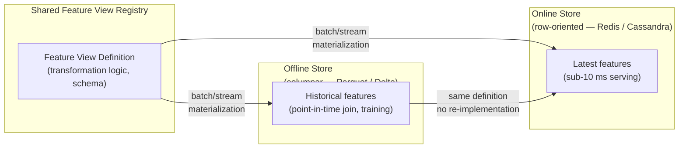

## Point-in-Time Joins — The Mechanism

- A point-in-time join prevents temporal leakage by retrieving, for each training example, only feature values whose timestamp is at or before the label's event_timestamp — ensuring that no future information is used during model training. [claim:agde:013]

<!-- Speaker: Introduce as-of semantics concretely: for each row in the entity DataFrame, Feast finds the latest matching feature record where feature_ts ≤ event_timestamp. That single constraint eliminates the temporal leak from slide 11. -->

<!-- Notes:
The core idea is simple but easy to get wrong: you want the feature value that would have been visible at the moment the label was generated, not the value that exists today or at query time. Feast's as-of join enforces this by treating the event_timestamp column on the entity DataFrame as an upper bound on feature timestamps.

Students often ask why a standard equi-join fails here. The answer is that customer attributes like credit_tier or churn_flag change over time, so joining on customer_id alone pulls the most recent value, which can reflect information only available after the transaction occurred. The point-in-time join solves this by treating the feature table as a slowly changing dimension and selecting the "last known good value" per entity at the moment of each event.

This semantics is what Feast documents as "point-in-time correctness" and is the primary value proposition of the offline feature store retrieval API over a plain SQL JOIN.
-->

---

## Point-in-Time Join in SQL (ANSI Window Function)

- Point-in-time joins can be implemented in standard ANSI SQL using window functions (added in SQL:2003/2008) or LATERAL correlated subqueries; these portable approaches are functionally equivalent to dialect-specific ASOF JOIN but typically execute more slowly because the optimizer cannot apply the same merge-join strategy. [claim:agde:017]

```sql
-- Point-in-time join: retrieve each customer's latest attributes
-- as of the transaction timestamp, using ANSI ROW_NUMBER().
-- transactions(tx_id, customer_id, tx_ts, amount)
-- customer_dim(customer_id, credit_tier, churn_flag, updated_at)

WITH ranked_features AS (
    SELECT
        t.tx_id,
        t.customer_id,
        t.tx_ts,
        t.amount,
        c.credit_tier,
        c.churn_flag,
        ROW_NUMBER() OVER (
            PARTITION BY t.tx_id
            ORDER BY c.updated_at DESC
        ) AS rn
    FROM transactions t
    JOIN customer_dim c
        ON t.customer_id = c.customer_id
        AND c.updated_at <= t.tx_ts   -- as-of constraint
)
SELECT tx_id, customer_id, tx_ts, amount, credit_tier, churn_flag
FROM ranked_features
WHERE rn = 1;
```

<!-- Speaker: Walk through the WHERE clause rn = 1: among all customer_dim rows valid at or before tx_ts, pick the most recent one. Note that this requires a full join before filtering, so the optimizer cannot use a merge strategy — it is slower than dialect-specific ASOF JOIN. -->

<!-- Notes:
The ROW_NUMBER() window function partitions by the training example's primary key (tx_id) and orders feature rows by updated_at DESC, then filters to rn = 1. This gives the most recent feature row whose timestamp does not exceed the event timestamp.

The critical line is the join predicate AND c.updated_at <= t.tx_ts. Without this inequality, a standard equi-join on customer_id alone would retrieve the current value of credit_tier, introducing future data.

The performance limitation is real: the database must materialise the full join result and then apply the window function before filtering. Dedicated ASOF JOIN implementations avoid this by sorting or hash-partitioning the right-hand side once and using a binary search per probe row. For large training set construction runs (millions of training examples joined to billions of feature rows), this difference can translate to hours of wall time.

This ANSI pattern is portable across PostgreSQL, BigQuery, Snowflake, Spark SQL, and most other dialects — useful when the team doesn't control the query engine or needs a single implementation that works everywhere.
-->

---

## ASOF JOIN — Dialect-Specific Fast Path

- Dialect-specific ASOF JOIN syntax exists in DuckDB, ClickHouse, and kdb+; the concept originates from kdb+'s aj (as-of join) operator used extensively in quantitative finance; ClickHouse adopted it in 2019 with the constraint that an equality condition must accompany the inequality; DuckDB's implementation hash-partitions and sorts the right-hand side and benchmarks several orders of magnitude faster than equivalent window-function queries. [claim:agde:016]

```sql
-- DuckDB ASOF JOIN: finds the latest customer_dim row
-- where updated_at <= tx_ts, per customer_id.
-- Semantically equivalent to the ANSI window-function version
-- but uses DuckDB's optimised merge-join path.

SELECT
    t.tx_id,
    t.customer_id,
    t.tx_ts,
    t.amount,
    c.credit_tier,
    c.churn_flag
FROM transactions t
ASOF JOIN customer_dim c
    ON t.customer_id = c.customer_id        -- equality predicate (required)
    AND t.tx_ts >= c.updated_at;            -- as-of inequality
```

<!-- Speaker: Mention the kdb+ origin (aj operator, ubiquitous in quant finance), ClickHouse 2019 adoption, and DuckDB's hash-partition implementation. The syntax reads naturally: "join customer_dim as-of the transaction timestamp." Contrast with the five lines of window-function boilerplate above. -->

<!-- Notes:
The ASOF JOIN concept comes from the time-series finance world where kdb+'s aj (as-of join) is standard tooling. The semantics are: for each row on the left side, find the single row on the right side with the greatest right-side timestamp that does not exceed the left-side timestamp, subject to any equality predicates (here customer_id must match).

DuckDB's implementation hash-partitions the right-hand table on the equality key (customer_id) and sorts each partition by the ordering key (updated_at). Each probe on the left side then uses a binary search within its partition, turning an O(n·m) join into O(n log m). The documentation notes benchmarks several orders of magnitude faster than equivalent window-function queries on the same data.

ClickHouse adopted ASOF JOIN in 2019 and explicitly credits kdb+ as the design reference. It requires at least one strict equality condition alongside the inequality — the same constraint appears in DuckDB's syntax above (ON t.customer_id = c.customer_id).

For training set construction on large corpora, the practical advice is: use ASOF JOIN when the engine supports it and fall back to the ANSI ROW_NUMBER() pattern for portability. Both are semantically correct; the difference is purely in execution efficiency.
-->

---

## Feature Store Architecture — The Three-Part Pattern

- A feature store's offline/online/shared-transformation-definition pattern eliminates training-serving skew by enforcing that both the historical training path and the real-time serving path execute the same feature computation logic, declared once in a shared feature view registry. [claim:agde:014]



<!-- Speaker: The key insight is the single shared definition: training and serving both read from the same feature view, so the transformation code cannot diverge. Without a feature store, teams re-implement feature logic in two codebases — the divergence is where skew enters. -->

<!-- Notes:
The diagram shows three components. The feature view registry holds the authoritative definition of each feature: its input columns, transformation logic, entity keys, and schema. Both the offline store (used for historical retrieval during training) and the online store (used for sub-10 ms prediction serving) are populated by the same materialization job that reads from this single definition.

This architecture directly addresses the root cause identified in the skew section: divergent code paths. Without a feature store, a data scientist writes feature engineering in Python for a training notebook, and a separate software engineer re-implements that logic in Java or SQL for the serving API. Any discrepancy between the two implementations becomes training-serving skew.

The offline store is typically columnar (Parquet on S3, Delta Lake, or BigQuery) because training requires reading large time ranges across many rows. The online store is row-oriented and low-latency (Redis, DynamoDB, Cassandra) because serving requires fetching a single entity's features in single-digit milliseconds.

Feast, Tecton, Vertex AI Feature Store, and Hopsworks all implement this three-part pattern. The specific technologies differ but the architectural contract — single definition, two stores, one materialization path — is consistent across all major implementations.
-->

---

## The Second Consistency Problem — Offline/Online Staleness

- The offline/online store split in a feature store introduces a second consistency problem: the online store must be periodically materialized from the offline store, creating a window of staleness during which the two stores diverge; if materialization writes to only one store, eventual consistency breaks. [claim:agde:015]

<!-- Speaker: The feature store solves skew but creates a new problem: the online store is a materialized snapshot, not a live view. Between materialization runs, the two stores diverge. If a job writes to only the offline store and crashes before updating the online store, they are permanently inconsistent. -->

<!-- Notes:
This is an important "cost of the solution" slide. Students need to understand that the feature store's dual-store architecture trades one class of problem (training-serving skew from divergent code) for another (temporal inconsistency between stores).

The staleness window is determined by the materialization job frequency. If the job runs every hour, the online store may serve features that are up to an hour old relative to the offline store. For some use cases (daily batch inference) this is acceptable; for others (fraud detection at transaction time) it may not be.

The consistency breakage scenario is subtle: a materialization job must write atomically to both stores, or implement a replication protocol with defined consistency guarantees. If the job writes to the offline store and fails before writing to the online store, the two diverge permanently until corrective action. Hopsworks' documentation explicitly warns that "if the dataframe is only merged into one but not the other, it will break eventual consistency."

Practical mitigations include: dual-write transactions where the store infrastructure guarantees both writes, change data capture from the offline store to the online store, and monitoring that compares the latest timestamp in each store to detect divergence. This is an active area of engineering in production feature store deployments.
-->

---

## When NOT to Adopt a Feature Store

- A feature store is not warranted for a single-model, single-team, batch-only inference use case: when feature engineering, model training, and serving all run on a fixed batch schedule with no real-time latency requirements, the online store and materialization infrastructure add operational cost with no benefit, and simpler alternatives (SQL tables with versioned transformation scripts) suffice. [claim:agde:018]

<!-- Speaker: Feature stores solve real problems, but only at a specific operating point. Before adopting one, ask three questions: Do you have multiple models or teams sharing features? Do you need sub-second serving latency? Do you have streaming features? If all three answers are no, SQL tables with versioned scripts are simpler and sufficient. -->

<!-- Notes:
This slide guards against the common pattern of adopting infrastructure because it is fashionable rather than because it solves a present problem. Feature stores introduce real operational overhead: a metadata server, two separate storage backends, materialization jobs, and a new failure mode (offline/online divergence).

The qualifying conditions for a feature store are: (1) multiple models or teams that need to share and reuse features — the shared registry pays off when it reduces duplication; (2) real-time or near-real-time inference requiring sub-10 ms feature lookup — the online store exists for this; (3) streaming feature sources where values change frequently and must be reflected at serving time.

When none of these conditions hold — a single data science team, batch inference on a daily schedule, no feature sharing requirements — a well-organised dbt project or a set of versioned SQL transformation scripts achieves the same outcome with no additional infrastructure. The training and serving pipelines both read from the same SQL-defined tables, so there is no divergent code path and hence no skew.

The practical test from the Made With ML course is simple: "Do you need an online store?" If the answer is no (because inference is batch and latency-insensitive), there is no reason to run the rest of the feature store stack. Start simple and adopt only when the complexity is justified by the problem.
-->
