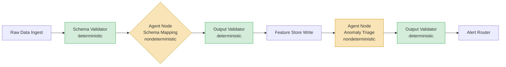

## What Is an Agent? (Precise Definition)

- An AI agent is an LLM autonomously using tools in a loop, where the loop continues until a stopping condition — task completion or explicit termination — is reached [claim:agde:051]
- This structure makes agents distinct from a single LLM call (no loop) and from rule-based automation (no LLM reasoning) [claim:agde:051]

<!-- Speaker: Establish the definition before any use cases — precision here prevents the word 'agent' from becoming a catchall. Transition: with this definition in hand, look at what happens when the loop has no stopping condition. -->

<!-- Notes:
The Anthropic definition is deliberately minimal: LLM + tools + loop + stopping condition. This matters for engineering decisions because it determines whether a system truly needs an agent pattern or whether a simpler chain of LLM calls or a deterministic script will suffice. The "no loop" boundary rules out one-shot prompt-response systems regardless of how sophisticated the prompt is. The "no LLM reasoning" boundary rules out classical automation pipelines with hard-coded branching logic. Instructors should ask students: given this definition, is a chatbot an agent? (Only if it uses tools and loops — a purely conversational chatbot without tool use is not an agent by this definition.) The stopping condition is the most commonly omitted engineering requirement in early implementations, and its absence is the direct root cause of the cost-explosion incident on the next slide.
-->

---

## Production Case Study — The Expensive Nondeterministic Cron Job

- In 2025, GetOnStack's multi-agent market-data research system escalated from $127/week to $47,000 in API costs over four weeks due to an infinite conversation loop between two agents (Agent A and Agent B) running undetected for 11 days [claim:agde:053]
- Root causes: no per-agent budget ceiling and no external stopping condition that would have terminated the session before the next API call [claim:agde:053]

<!-- Speaker: This is the most memorable slide in Section I — give it time. The mechanism: Agent A asked Agent B for clarification; Agent B asked Agent A for clarification; neither had logic to break the cycle. Transition: bounded problems are where agents earn their place. -->

<!-- Notes:
The GetOnStack incident illustrates the "expensive nondeterministic cron job" failure mode directly. Unlike a buggy cron job that fails and stops, an agent loop that enters a mutual-clarification cycle between two sub-agents is self-sustaining and generates cost at every iteration. The two missing guardrails are straightforward engineering controls: a per-agent token or cost budget that raises an exception when exceeded, and an external timeout or iteration limit enforced by the orchestrator rather than by the agents themselves. Students should note that 11 days of undetected runaway cost is also a monitoring failure — the incident would have been far cheaper with basic cost-per-job alerting. Instructors can connect this to the stopping-condition component of the agent definition from the previous slide: an absent stopping condition is not a theoretical concern, it is a quantifiable production risk.
-->

---

## Where Agents Earn Their Place — Bounded Problems

- A production survey of 1,200 LLMOps deployments found that agents succeed on specific, bounded problems — for example, Ramp's policy agent handles 65% of expense approvals autonomously — but fail when given open-ended tasks [claim:agde:052]
- The highest-stakes production systems do not try to remove humans from the loop entirely [claim:agde:052]

<!-- Speaker: Pair this with the previous slide: the GetOnStack system was likely open-ended by design. Ramp's success comes from a well-specified approval policy with explicit acceptance criteria — the task boundary is tight. -->

<!-- Notes:
The 1,200-deployment survey provides empirical grounding for what is otherwise an intuition: agents work when the task has a clear success criterion that the agent can check, a bounded action space that limits what can go wrong, and measurable outputs that enable evaluation. Expense-approval policy checking satisfies all three. Open-ended research tasks satisfy none. The finding that high-stakes systems keep humans in the loop is important for data engineering: agents that modify production schemas, drop partitions, or trigger backfills should route high-impact decisions for human approval rather than acting autonomously. This connects directly to the autonomy maturity ladder on slide 55. Instructors should ask: what property of expense approval makes it well-suited to agents that does not hold for, say, schema refactoring?
-->

---

## Data Engineering Agent Use Cases and Their Failure Modes

- Providing agents with live metadata — certifications, definitions, lineage context — versus bare schemas produces a 3x improvement in text-to-SQL accuracy; LLM-based metadata description generation achieves over 80% ROUGE-1 F1 and approximately 90% acceptance by data stewards [claim:agde:057]
- The most effective production systems apply a hybrid architecture: deterministic components (retrieval, validation, permissions) are implemented in infrastructure with hard guarantees, while nondeterministic components (reasoning, generation) are constrained through tool limitations and staged decision-making [claim:agde:055]

<!-- Speaker: Four concrete use cases fall out of these two claims: text-to-SQL with live metadata, lineage and doc generation, schema mapping, and data-quality triage. Each has a well-defined output the agent can be evaluated on. -->

<!-- Notes:
The text-to-SQL accuracy improvement from live metadata injection is large enough to be decisive: the agent is not reasoning better, it is reasoning with better inputs. This is a retrieval-augmented agent pattern — structurally similar to RAG but the retrieved context is schema metadata rather than document chunks. The 80% ROUGE-1 F1 and 90% steward-acceptance rate for automated metadata generation are strong enough to justify partial autonomy; the 10% rejection rate sets the floor for the human-in-the-loop requirement. The hybrid architecture point (claim:agde:055) is the architectural principle underlying all four use cases: wrap the nondeterministic agent step with deterministic validation on both the input (what the agent receives) and the output (what the agent produces). Common student misconception: "if the LLM is good enough, we don't need the deterministic wrapper." The evidence shows that deterministic validation layers independently improve reliability even for state-of-the-art models.
-->

---

## Architectural Principle — Narrowing the Nondeterministic Boundary

- The most effective production systems apply a hybrid architecture: deterministic components (retrieval, validation, permissions) are implemented in infrastructure with hard guarantees; nondeterministic components (reasoning, generation) are constrained through tool limitations and staged decision-making [claim:agde:055]
- Stripe's compliance-review system, using this pattern, achieved 96% helpfulness and a 26% reduction in average handling time [claim:agde:054]

<!-- Speaker: The principle is: push nondeterminism to the narrowest possible scope. Everything that can be deterministic should be. The LLM occupies the reasoning slot that cannot be made deterministic any other way. -->

<!-- Notes:
This slide generalizes the architectural lesson from the use-case slide. The hybrid principle is a direct response to the reliability problem in nondeterministic systems: you cannot eliminate nondeterminism from an LLM-based system, but you can confine it. Retrieval is deterministic (same query, same index, same results). Validation against a schema or business rule is deterministic. Permission checks are deterministic. The LLM is called only for the reasoning step, and its output is immediately validated by a deterministic layer before any action is taken. Stripe's 96% helpfulness rate with 26% AHT reduction is a strong commercial outcome, but instructors should note that it comes from a compliance domain where the task structure is well-defined — the DAG of investigation steps is fixed, and the agent navigates it rather than designing it. Students sometimes conflate "the agent decides what to do" with "the agent does the work within a predefined structure" — Stripe's architecture is the latter.
-->

---

## Agents as DAG Nodes, Not Orchestrators

- Decomposing complex workflows into a DAG with agents as bounded nodes prevents agents from "rabbit-holing" and contains the blast radius of unexpected model behavior to a single task [claim:agde:054]

<!-- Speaker: The diagram shows agent nodes (yellow) sitting between deterministic validation steps (green) inside a larger pipeline DAG. The anti-pattern is a single agent node that spans the whole graph — that is the GetOnStack architecture. -->

<!-- Notes:
The DAG-node pattern is the structural implementation of the narrowing-nondeterminism principle from the previous slide. Each agent node has: a deterministic input contract (validated before the agent sees it), a bounded action space (the tools the agent is permitted to call), and a deterministic output contract (validated before downstream nodes receive it). The "rabbit-holing" prevention comes from the DAG structure itself — an agent node cannot extend its own subgraph, so it cannot spawn sub-agents or recursively call itself unless the DAG explicitly encodes that. Contrast with the orchestrator anti-pattern: an agent that orchestrates the whole pipeline can modify its own execution graph, has no external stopping condition, and has access to all downstream systems. Instructors should connect this diagram back to the GetOnStack incident: the Analyzer-Verifier loop was two agent nodes with a direct edge between them and no DAG-level timeout enforced externally. The fix is adding a deterministic iteration counter at the DAG level, not inside either agent.
-->

---

## The Autonomy Maturity Ladder

- Production deployments follow a three-stage progressive autonomy ladder: (1) suggestions only — AI presents recommendations for human review; (2) autonomous for high-confidence cases — agent acts on high-confidence cases without waiting for approval; (3) human approval for edge cases — low-confidence or out-of-policy decisions are routed for human review [claim:agde:056]
- Ramp implements this as a user-controlled autonomy slider allowing teams to set dollar limits and approval requirements matching their risk tolerance [claim:agde:056]

<!-- Speaker: The ladder is not a timeline — teams can stay at stage 1 indefinitely for high-risk pipelines. The slider metaphor is useful: different pipeline stages warrant different autonomy levels even within the same system. -->

<!-- Notes:
The autonomy ladder provides a practical framework for incrementally deploying agents in data engineering pipelines without betting on full autonomy from day one. The suggest-only stage is zero-risk from an automated-action standpoint — the agent produces output that a human acts on, so errors are caught before they affect production. This stage is appropriate for any pipeline action that modifies production data or schemas. The autonomous-for-high-confidence stage is appropriate once the agent's accuracy on a specific task is well-characterized and the high-confidence threshold is empirically determined. Crucially, the third stage is not "fully autonomous" — human approval remains a permanent requirement for edge cases, not a temporary scaffold to be removed. Ramp's autonomy slider is an example of encoding autonomy policy as a runtime parameter rather than a deployment configuration, enabling fine-grained control per use case. Instructors should ask: for a data-quality triage agent that can create Jira tickets, which stage is appropriate on day one, and what evidence would you need to advance to stage 2?
-->
