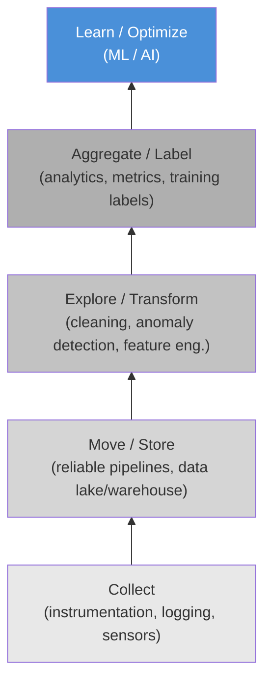

## Silent Failure — ML vs. BI Pipelines

- ML models continue producing predictions whose quality degrades without raising any operational alarm, unlike traditional software that crashes with errors or timeouts [claim:agentic-de:001]
- ML consumption shifts data's role from "query target" (BI: run SQL against the current state) to "versioned, time-aware artifact" (ML: the exact dataset snapshot that produced a model must be reproducible) [claim:agentic-de:005]

<!-- Speaker: Contrast BI dashboards, which visibly break when data is wrong, with ML models that keep predicting silently with degraded quality. This is the foundational motivation for the entire lecture. -->

<!-- Notes:
This slide sets the stage for everything that follows. In a BI pipeline, a broken JOIN or a missing column surfaces immediately — a dashboard shows NULL or an error. An ML model, by contrast, will happily ingest corrupted or stale features and still return a prediction. The prediction just gets worse, and nobody notices until business metrics decline days or weeks later.

The second bullet reframes what "data" means once ML enters the picture. In BI, data is a live query target — you always want the freshest state. In ML, you need to know exactly which version of the data produced a given model, so you can reproduce results, debug regressions, and audit predictions. This versioned, time-aware view of data is what drives the need for point-in-time joins, dataset versioning, and lakehouse time-travel — all topics we cover later in this lecture.

A useful analogy: BI pipelines are like reading a newspaper (always today's edition), while ML pipelines are like maintaining a library archive (every edition must be retrievable).
-->

---

## The Data Science Hierarchy of Needs

- Monica Rogati's "AI Hierarchy of Needs" (2017) frames AI/ML as the top of a pyramid whose foundational layers are data collection, infrastructure, exploration/transformation, and analytics/features — organizations must build these data layers before they can effectively use ML [claim:agentic-de:003]
- A 2016 CrowdFlower survey found that data scientists spend roughly 80% of their time on data preparation: 60% cleaning and organizing data, 19% collecting datasets [claim:agentic-de:004]
- In real-world ML systems, the actual ML code is only a small fraction of the total system; surrounding infrastructure for data collection, feature extraction, configuration, monitoring, and serving dwarfs the model code [claim:agentic-de:002]

<!-- Speaker: Walk through the pyramid bottom-up. Emphasize that most effort — and most technical debt — lives in the lower layers, not in the model itself. Transition by noting that feature engineering sits right at that boundary between infrastructure and modeling. -->

<!-- Notes:
Rogati's pyramid is the ML equivalent of Maslow's hierarchy: you cannot self-actualize (build effective AI) if you have not satisfied basic needs (reliable data collection and infrastructure). The CrowdFlower statistic reinforces this empirically — data scientists spend the vast majority of their time on data work, not model tuning.

Sculley et al.'s "Hidden Technical Debt in Machine Learning Systems" (NeurIPS 2015) provides the complementary systems-engineering view: the famous diagram shows a tiny black box labeled "ML Code" surrounded by a sprawling ecosystem of data verification, feature extraction, configuration, monitoring, and serving infrastructure. The implication is that most bugs, most maintenance burden, and most technical debt accumulate outside the model.

For students who already know batch ETL and data-quality contracts, the key takeaway is that ML does not replace those concerns — it adds new ones on top. The pipeline must now guarantee not just correctness and freshness, but also reproducibility, temporal consistency, and statistical stability.
-->

---

## Feature Engineering as a Stateful Pipeline Stage

- Transformations that require full-pass statistics — computing mean, standard deviation, vocabulary, or quantile boundaries over the training set — are stateful: the statistics must be persisted and reapplied identically at serving time to avoid training-serving skew [claim:agentic-de:006]

| Transformation | Stateful? | Persisted Artifact |
|---|---|---|
| Standardization (z-score) | Yes | mean, std per feature |
| One-hot encoding | Yes | vocabulary mapping |
| TF-IDF | Yes | IDF vector, vocabulary |
| Quantile binning | Yes | bin boundaries |
| Log transform | No | (formula only) |

<!-- Speaker: Use this table to make the stateful vs. stateless distinction concrete. Point out that every "Yes" row requires an artifact that must travel from training to serving — this is where skew enters if the pipeline is not careful. This sets up the next section on training-serving skew. -->

<!-- Notes:
This slide bridges the infrastructure discussion (previous slides) to the skew discussion (next section). The critical insight is that many common feature transformations are not pure functions of a single input row — they depend on aggregate statistics computed over the entire training set.

For example, z-score standardization subtracts the training-set mean and divides by the training-set standard deviation. If the serving pipeline recomputes these statistics on a different data distribution (or worse, on a single incoming row), the resulting feature values will differ from what the model saw during training. This mismatch is training-serving skew.

The table makes the pattern explicit. Students should recognize that any transformation requiring a "fit" step (in scikit-learn terms, any transformer with a fit() method that stores state) is stateful. The persisted artifact — whether a JSON file, a TFX Transform artifact, or a feature-store definition — is a first-class pipeline dependency that must be versioned alongside the model.

A common misconception: students sometimes think that re-fitting on serving data is acceptable because it "adapts to the current distribution." This conflates drift mitigation (a deliberate retraining decision) with skew introduction (an accidental inconsistency). The two must be handled through separate, explicit mechanisms.
-->
