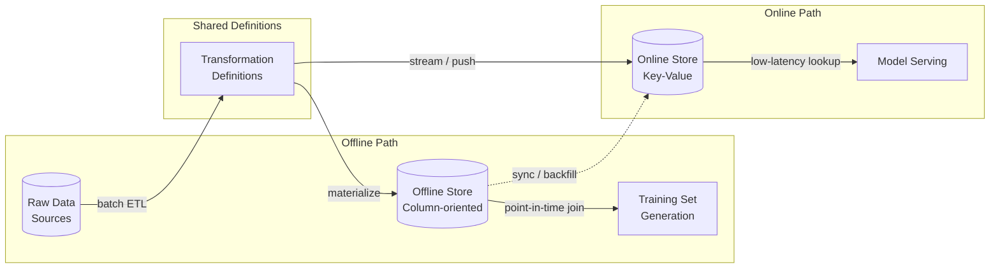

## Point-in-Time / As-Of Joins

- A point-in-time (as-of) join retrieves, for each training example, the latest feature value that existed at or before the label timestamp, preventing temporal leakage [claim:agentic-de:013]
- ASOF JOIN is a dialect-specific SQL extension — originally from kdb+, now supported by DuckDB, ClickHouse, and Snowflake — while databases lacking it must emulate it with LATERAL JOIN or ROW_NUMBER window functions [claim:agentic-de:014]

**ANSI-standard emulation (portable):**

```sql
SELECT l.customer_id,
       l.label_ts,
       l.fraud_label,
       f.credit_limit,
       f.feature_ts
FROM   labels l
LEFT JOIN LATERAL (
    SELECT c.credit_limit,
           c.updated_at AS feature_ts
    FROM   customer c
    WHERE  c.customer_id = l.customer_id
      AND  c.updated_at <= l.label_ts
    ORDER  BY c.updated_at DESC
    LIMIT  1
) f ON true;
```

**Dialect-specific ASOF JOIN (DuckDB):**

```sql
SELECT l.customer_id,
       l.label_ts,
       l.fraud_label,
       c.credit_limit,
       c.updated_at AS feature_ts
FROM   labels l
ASOF JOIN customer c
       ON l.customer_id = c.customer_id
      AND l.label_ts >= c.updated_at;
```

<!-- Speaker: Walk through both SQL variants side by side. Stress that the LATERAL approach works everywhere but is verbose; the ASOF JOIN is concise but locks you into specific engines. -->

<!-- Notes:
The as-of join is the direct remedy for the temporal leakage problem shown on the previous slide. For each label row, we want the most recent customer snapshot that existed *before* the label timestamp — nothing newer. The ANSI approach uses a correlated LATERAL subquery that filters by timestamp, orders descending, and takes the first row. This works on PostgreSQL, Spark SQL (via subquery), and any engine supporting LATERAL. The DuckDB ASOF JOIN is syntactic sugar for the same logic: the engine internally finds the closest matching row where the right-side timestamp is at or before the left-side timestamp. kdb+'s aj (as-of join) function was the original implementation, designed for tick-by-tick financial data where temporal alignment is a first-class concern. ClickHouse added ASOF JOIN support in 2019 for time-series analytics. When choosing between approaches, consider portability: if the pipeline must run on multiple engines (e.g., Spark for training, PostgreSQL for serving), stick with the ANSI pattern to avoid skew from dialect differences.
-->

---

## Feature Store Architecture

- A feature store prevents training-serving skew through a three-part architecture: an offline store (column-oriented, for batch training-set generation), an online store (row-oriented / key-value, for low-latency serving), and shared transformation definitions ensuring both stores apply identical logic [claim:agentic-de:015]
- The dual-store design introduces a second consistency problem: keeping offline and online stores synchronized, since batch features may take minutes or hours to compute and streaming features have inherent network latencies, causing online features to become stale [claim:agentic-de:016]



<!-- Speaker: Trace the three components: shared transformation definitions feed both the offline column store and the online key-value store. Highlight that the sync arrow is where the second consistency problem lives — staleness between offline and online. -->

<!-- Notes:
The feature store solves the skew problem from the previous section by centralizing transformation logic in a single definition layer. The offline store is typically backed by a data warehouse or lakehouse (Parquet on S3, Delta Lake, BigQuery) and is optimized for bulk reads — generating entire training sets via point-in-time joins. The online store is a low-latency key-value system (Redis, DynamoDB, Bigtable) optimized for single-row lookups during model serving. The critical architectural insight is the shared transformation definitions: both stores compute features using the same code, so a raw input maps to the same feature vector whether it is processed in a batch pipeline or a real-time serving request. However, this dual-store design introduces its own consistency challenge. Batch features may be computed hourly or daily, and the online store may lag behind. Streaming features written via Kafka or similar brokers have inherent network latencies and at-least-once delivery semantics that can introduce duplicates. The sync arrow in the diagram represents this gap — and monitoring it is an operational concern that teams adopting a feature store must plan for.
-->

---

## When NOT to Adopt a Feature Store

- A feature store adds ecosystem-level complexity without payoff when the organization has a single model, a single ML team, or batch-only inference: batch pipelines have enough time to compute features on demand, and there is no cross-team reuse to amortize the overhead of an offline/online dual-store, streaming pipeline, and synchronization mechanism [claim:agentic-de:017]

**Adopt when you have:**
- Multiple models sharing features across teams
- Real-time serving with sub-100ms latency requirements
- Point-in-time correctness needed across many feature/label combinations

**Skip when you have:**
- One model, one team, batch scoring
- Features computed and consumed within the same pipeline
- No online serving requirement

<!-- Speaker: This is an important counterpoint to vendor marketing. Emphasize that a feature store is an ecosystem commitment — offline store, online store, streaming pipeline, orchestrator, sync mechanism — not a library you pip-install. -->

<!-- Notes:
This slide provides a necessary counterbalance to the feature store enthusiasm in the previous slide. The feature store ecosystem includes not just the dual storage layer but also a streaming pipeline for real-time ingestion, an orchestrator for batch materialization, a synchronization mechanism between offline and online stores, and a registry for feature metadata. For a team with a single model running batch inference nightly, all of this machinery is overhead: they can compute features in the same Spark job that trains the model, and there is no online store to keep in sync. The cross-team reuse argument is the strongest justification for adoption — when multiple teams independently re-derive the same features (e.g., "customer 30-day transaction count"), a shared feature store eliminates duplicated computation and ensures consistency. The decision heuristic is straightforward: if you would not build a shared data warehouse for your analytics team, you probably do not need a feature store for your ML team. Start with a well-structured feature pipeline in your orchestrator (Airflow, Dagster) and adopt a feature store only when the pain of cross-team duplication or online-serving latency demands it.
-->
