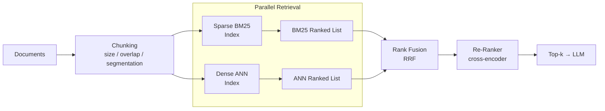

## RAG as a Two-Stage Data Pipeline

- Chunking strategy is a foundational design decision: chunk size, overlap, and segmentation method define retrieval quality, and a well-tuned strategy can improve retrieval accuracy by up to 40% compared to naive approaches [claim:agentic-de:043]
- Hybrid retrieval runs sparse BM25 and dense ANN search in parallel, then fuses the two ranked lists — ensuring lexical matches the dense model ranks too low (error codes, IP addresses, config flags) are not lost [claim:agentic-de:044]

<!-- Speaker: Walk through the diagram left to right. Emphasise that RAG retrieval is not a single similarity lookup but a multi-stage pipeline, and that chunking is the "schema design" decision of this pipeline. -->

<!-- Notes:
Students already know ETL pipelines; the goal here is to reframe RAG retrieval in
familiar data-engineering terms. Chunking is analogous to schema design — it determines
the granularity and boundaries of the data units downstream stages operate on. A poor
chunking strategy (e.g., fixed 512-token windows with no overlap) can split a key
paragraph across two chunks, making neither chunk independently useful.

The parallel retrieval pattern (BM25 + ANN) mirrors the broadcast-join pattern they
have seen in Spark: two independent scans whose results are merged. BM25 excels at
exact token matches that embedding models often under-rank (short literal strings like
error codes or configuration keys), while dense retrieval captures semantic similarity.
The fusion and re-ranking stages are covered on the next slide.
-->

---

## Hybrid Search, RRF, and Re-Ranking

- **Reciprocal Rank Fusion (RRF)** combines ranked lists by scoring each document *d* as RRFscore(*d*) = &sum; 1/(*k* + rank(*d*)), where *k* is typically 60; it requires no score normalisation and outperforms both Condorcet Fuse and individual rank-learning methods [claim:agentic-de:045]
- **Cross-encoder re-ranking** is the second stage: a bi-encoder retrieves 50-100 candidates quickly, then a cross-encoder jointly encodes each (query, document) pair to produce a refined relevance score, reordering candidates so the top 5-10 passed to the LLM are the most relevant [claim:agentic-de:046]
- **Recall vs. precision separation**: hybrid search improves recall (surfaces lexical matches the dense model misses), while re-ranking improves precision (reorders the already-retrieved set); a re-ranker cannot fix recall because it never sees documents that were not retrieved in the first stage [claim:agentic-de:047]

<!-- Speaker: Stress the clean separation of concerns — hybrid search widens the net (recall), re-ranking tightens it (precision). Ask students: "Can a re-ranker recover a document that was never retrieved?" -->

<!-- Notes:
RRF is attractive in practice because it is parameter-light: the only tunable is k
(defaulting to 60 in the original paper by Cormack, Clarke, and Büttcher, 2009). Unlike
score-based fusion, RRF needs no normalisation across retrieval systems whose raw scores
live on different scales — BM25 produces unbounded floats while cosine similarity is
bounded to [-1, 1].

The bi-encoder / cross-encoder distinction maps to a latency-accuracy trade-off students
will recognise from database indexing: the bi-encoder is the "index scan" (fast, approximate),
while the cross-encoder is the "nested-loop verify" (slow, precise). Cross-encoders
jointly attend to query and document tokens, enabling richer interaction modelling at
the cost of O(N) forward passes instead of a single embedding lookup.

A common misconception is that adding a re-ranker always improves end-to-end quality.
It improves precision among retrieved candidates, but if the first-stage retrieval
missed a critical document entirely, no amount of re-ranking can recover it. This
motivates the hybrid approach in the first stage.
-->

---

## The Top-k Cutoff Failure Mode

- A canonical RAG failure occurs when a relevant chunk is retrieved but ranked just outside the top-k cutoff (e.g., at position 11 when k = 10) — the system indexed and retrieved the document, but the LLM never sees it, upper-bounding generation quality by the missing evidence regardless of the model's reasoning capacity [claim:agentic-de:048]

<!-- Speaker: Make this concrete: "Your system found the answer, ranked it eleventh, and then threw it away." This motivates larger retrieval windows and re-ranking as mitigations. Transition to the next section on AI agents. -->

<!-- Notes:
This failure mode is subtle and insidious because no error is raised. The system
retrieved the document — it did not fail to index or embed it — but the rank-based
cutoff silently discards it. From the user's perspective, the LLM simply gives an
incomplete or incorrect answer with no indication that the relevant evidence existed
in the corpus.

Mitigations include: (1) increasing the initial retrieval window (retrieve 100, re-rank
to 10) so that borderline-relevant documents get a second chance via the cross-encoder;
(2) using hybrid search to diversify the candidate set; (3) adaptive k, where the
system inspects score distributions and extends the cutoff when scores are tightly
clustered near the boundary. None of these fully eliminate the problem — they shift the
boundary but do not remove it. Students should understand that every RAG system has a
top-k truncation point, and the design goal is to push relevant documents well above it,
not to pretend it does not exist.

This is a good place to connect back to the earlier discussion of recall as a silently
violated SLO (Slide 23): there is no alarm when recall degrades, and the top-k cutoff
is the mechanism through which that silent degradation manifests in RAG systems.
-->