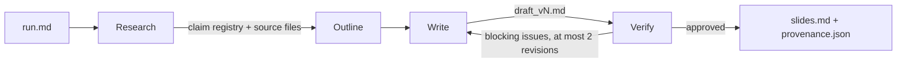
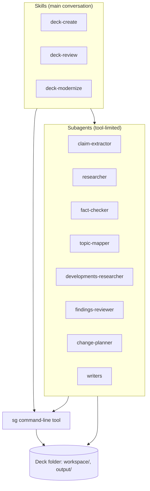
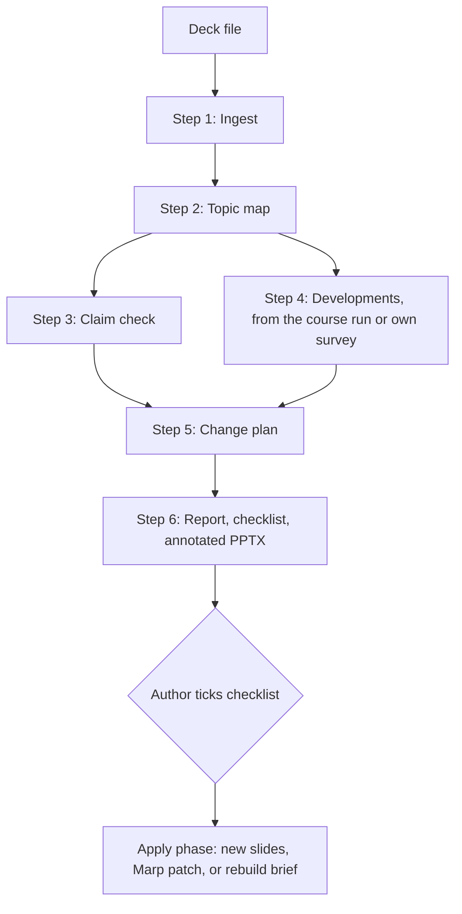
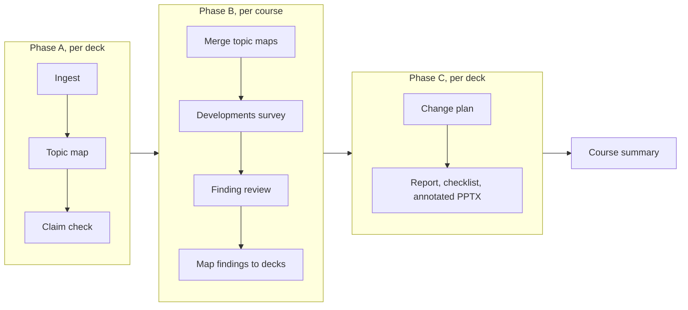
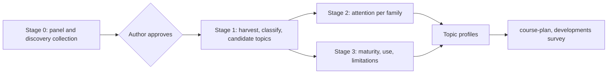

# SlideGen as a Claude Code plugin

**Status:** proposal, not implemented
**Date:** 2026-10-08
**Scope:** this repository (`slide-agent`)
**Review:** [slidegen-plugin-review.md](slidegen-plugin-review.md)

## 1. Summary

SlideGen generates lecture and practical-course decks whose factual bullets cite
stored sources, and it fact-checks existing decks. This document assesses the
current design and proposes packaging it as a Claude Code plugin with five skills
that any project producing slides can install:

- `course-plan` builds a reference curriculum for a course's subject from
  independent sources and proposes what each lecture should cover.
- `deck-create` builds a deck from a brief.
- `deck-review` checks an existing deck's claims, including whether they are
  still current.
- `deck-modernize` finds what is outdated in a deck and what the field now covers
  that the deck does not, and proposes a change plan. It runs on one deck or on
  a whole course.
- `deck-export` converts a Marp deck to PowerPoint.

The core method stays: research first, a claim registry as the source of facts,
adversarial checking against stored sources, and revision gated by severity. The
proposal changes five things:

1. **Bookkeeping becomes code.** One command-line tool, `sg`, does every step
   that has one correct answer: ingestion, source download, quote matching, ID
   assignment, merges, counts, gates, and plan bookkeeping. Prompts keep only the
   steps that need judgment.
2. **Sources are downloaded by `sg`,** and quotes are matched against the
   downloaded text. Today the researcher agent writes the source files itself.
3. **Every factual bullet must carry a claim tag.** Untagged factual bullets are
   found and treated as issues. Today 39% of bullets in finished decks carry no
   tag and are never checked.
4. **One claim check serves review and modernize.** It adds an OUTDATED verdict,
   and modernize also compares each deck with a survey of the current state of
   its topics.
5. **No dependence on this repository.** The system stops depending on its
   layout and on the local sandbox configuration, and it handles PowerPoint
   decks directly.

The first deliverable is the modernize report for one course. It takes last
year's decks and produces, for each deck, an annotated copy and a change plan,
plus a summary for the course.

## 2. Goals and non-goals

**Goals**

- Create, review, and modernize decks from any project.
- Accept existing decks as PPTX (optionally with a PDF export), PDF, or Marp
  Markdown.
- Enforce, rather than request, three rules:
  - every factual bullet carries a claim tag;
  - every claim's quote occurs in a downloaded source, or is marked as not
    machine-checked;
  - no deck is finalized while a CRITICAL or MAJOR issue is open.
- Make the yearly refresh of a course affordable: one batch over all of a
  course's decks, sharing the developments survey across decks.

**Non-goals for the first version**

- Editing the slides of a PPTX file in place. Modernize writes its suggestions
  into the speaker notes of a copy and builds new slides as a separate file; the
  author moves content into the deck.
- Visual design.
- Deciding what a course teaches. The tools propose; the instructor decides.

## 3. Current design

Three shell launchers (`slidegen.sh`, `coursegen.sh`, `slidereview.sh`) each run
`claude -p` with a prompt that names a pipeline file. The main Claude session
acts as orchestrator: it reads `pipelines/*.md`, reads the role prompts in
`agents/*.md`, and starts general-purpose subagents with those prompts. Scripts
in `tools/` split outlines into sections, concatenate drafts, and run code
blocks. Each deck lives in `decks/<name>/` with `run.md` (the brief),
`workspace/` (intermediate files), and `output/`.



- **Generate** (`pipelines/generate.md`, 451 lines).
  - One research subagent per learning objective builds the claim registry, and
    an outline agent structures the deck.
  - Writers produce sections in parallel.
  - Fact-checkers verify tagged citations in 3–4 parallel batches while a script
    runs marked code blocks.
  - At most three drafts are checked. A deck still blocked after the third check
    is not finalized.
- **Course** (`pipelines/course.md`, 298 lines).
  - It uses generate's research and checking, and adds exercise design, a
    participant workbook, and validation by an agent that runs each exercise
    prompt.
  - Its revision procedure differs from generate's. It regenerates every chunk
    that contains a flagged slide, and has no line-level edits, verdict
    hysteresis, or resampling.
- **Review** (`pipelines/review.md`, 69 lines). Ingest a deck, extract its
  claims, find sources, fact-check, and write a recommendations report.

The run settings — permissions, sandbox, and network allowlist — live in
`.claude/settings.json`, which `.gitignore` excludes. The launchers also need
`jq` and `timeout`.

## 4. Assessment

### 4.1 What works

- **Research before outline.** Writers take facts from the registry, so tagged
  bullets trace to a source.
- **Severity-gated revision.** CRITICAL and MAJOR issues block finalization;
  MINOR issues become advisory comments. This lets the revision loop converge.
- **Handling fact-checker non-determinism** (generate.md only). Verdicts for
  unchanged bullets carry forward, byte-identical text keeps its best historical
  verdict, and a newly blocking verdict needs 2 of 3 independent checks to count.
  These rules were committed on 2026-06-17 together with the last deck run
  (`agentic-dataengineering-r2`). No other deck has run with them, and course.md
  does not use them.
- **Exercises are run, not only read.**
- **Provenance.** `provenance.json` maps each claim to its source and the slides
  that use it.

### 4.2 Problems

**P1. Deterministic bookkeeping is written as prose.**
Most of generate.md Steps 3–5 is set arithmetic that the orchestrator executes
from text:
- build the citation list and compute the re-check set with three carry-forward
  rules;
- split the set into batches, check batch coverage, and merge verdicts;
- select citations for resampling and recompute counts;
- build writer feedback and rank iterations.

Evidence that this belongs in code:

- **Helper scripts written during runs.** The run logs show the orchestrator
  writing 28 helper scripts across 8 of 11 logged runs: re-check sets, review
  merges, checklists, and provenance builders (for example `build_recheck_v3.py`,
  `merge_reviews.py`, `merge_claims.py`). Seven of them remain in four deck
  workspaces.
- **Counts written by the model.** The review report in `query-engines-rev` says
  "Unsourced: 0", although its registry contains UNVERIFIED claims.
- **Two diverging procedures.** course.md reuses generate.md by reference with
  "form changes", but the two procedures differ in substance (section 3).

**P2. Untagged facts are never checked.**
The fact-check list is built from claim tags, and 607 of 1,541 bullets (39%) in
the 13 finished decks carry no tag. Some are not facts, such as agenda items and
exercise launch slides. Many are facts, for example "Merkle trees locate
divergence with O(log N) comparisons" in `dynamo-modernized`. Untagged bullets
pass unchecked.

**P3. Sources are written by the researcher, and quotes are not checked.**

- **Source files are model-written.** The researcher's WebFetch tool returns a
  small model's answer about a page, not the page text. Nothing confirms that a
  quote occurs at its URL.
- **Quotes and summaries are mixed.** Source files combine quotes with the
  researcher's own summaries, such as the "Extended context from Cassandra
  documentation" paragraphs in `dynamo-modernized`. The fact-checker cannot tell
  the two apart.
- **Two copies of a quote disagree.** The registry excerpt and the source file's
  copy of the same quote differ in 0–42% of claims per deck, 22% overall. In
  `query-engines2`, 17 of 76 excerpts are paraphrases rather than quotes.
- **Some sources hold no quote at all.** In the `query-engines-rev` review, 27 of
  43 claims have no excerpt. One source file holds the researcher's verdict
  ("PARTIALLY SUPPORTED / NEEDS QUALIFICATION") instead of a quote, and a
  reported finding rests on it.
- **No publication date.** The schema records when a source was retrieved but not
  when it was published.

**P4. Claim IDs are renumbered after research.**
The research merge renumbers IDs across objectives and renames the source files.
260 source files in 7 of 14 decks carry a different ID in their header than in
their filename. In two early decks (`iceberg-internals`, `query-engines`), most
registry IDs have no source file of that name. IDs can be made unique when they
are created.

**P5. Review cannot tell wrong from outdated, cannot see gaps, and mislabels
slides.**

- **Wrong and outdated share one verdict.** In `query-engines-rev`, a finding
  calls the deck's "in-memory only" description of Trino's fault tolerance
  misleading, because Trino offers fault-tolerant execution. Trino released that
  feature in 2022, years before this 2026 version of the deck. A misrepresentation
  needs a corrected sentence, and an outdated slide needs new content. The review
  also assigns no severities, and its report files every MISREPRESENTED verdict
  under "Critical Issues".
- **Gaps are invisible.** Review researches only the claims already on the
  slides, so it cannot report developments the deck omits.
- **Slide numbers are off by one.** Every slide number in that report is one too
  high. Text extraction invented a "Slide 1: Title Slide" that the PDF does not
  contain.
- **Smaller gaps.**
  - Review reuses research.md "with a key difference".
  - CRITICAL findings get no second check.
  - PPTX ingestion is an instruction to write an inline script.

**P6. Exercise validation grades its own output.**
In the only course run, the validator agent ran all six exercise prompts on its
own model (`claude-opus-4-6`) instead of on the brief's target tool, and then
graded the output it had produced.

**P7. Environment details live in prompts and in untracked settings.**
- The sandbox workaround (copy files with Python because Bash `cp` is blocked) is
  repeated in two pipeline files.
- The launchers hard-code an `fnm` Node path, and the three are nearly identical.
- Path-resolution rules appear in four places.
- The permission and network configuration is not in the repository.

**P8. One output format and two claim-tag styles.**
`tools/concat_draft.py` hard-codes the Marp frontmatter (`theme: default`).
Lecture decks show `[claim:id]` tags on the slides, which `agents/pptx.md` then
strips; course decks use hidden `<!-- claim:id -->` comments.

**P9. Repository hygiene and cost.**
- Untracked `gutenberg-500M.txt.gz` and `pipeline.joblib` sit at the repository
  root, and deck content shares the repository with the system.
- Logged sessions cost $7.20–31.05, with a median of about $12.80.
- Each relaunch overwrites the log, so restarted decks may have cost more. Batch
  estimates should start from the upper end.

## 5. Platform constraints

These facts from the Claude Code documentation shape the design.

| Constraint | Consequence |
|---|---|
| A skill with `context: fork` runs as a fork, and a fork cannot start subagents. A regular subagent can start subagents up to three layers below the main conversation (the default since v2.1.219, set by `CLAUDE_CODE_MAX_SUBAGENT_SPAWN_DEPTH`). At most 20 subagents run at once (`CLAUDE_CODE_MAX_CONCURRENT_SUBAGENTS`). | Orchestrating skills are not forked. A course run can start one subagent per deck, and each can start its own workers, in groups that stay under 20 concurrent subagents. |
| Under `claude -p`, a subagent does not wait for subagents it started in the background; their results arrive at the main conversation instead. | In headless runs, nested subagents are started in the foreground. |
| Plugins ship skills, agents, hooks, and workflows. `${CLAUDE_PLUGIN_ROOT}` and `${CLAUDE_SKILL_DIR}` are substituted in skill and agent Markdown, but are not set in the environment of Bash commands. | Skills put the absolute script path into the commands they tell the model to run. |
| Plugin agents set `tools` or `disallowedTools`, `model`, `maxTurns`, and preloaded skills. `permissionMode` and `hooks` in agent files are ignored. | Each role gets only the tools it needs and a model sized to its task. |
| Plugin settings cannot carry permission rules. A skill's `allowed-tools` frontmatter pre-approves tools for the turn that invokes the skill, and a headless `claude -p "/slidegen:…"` run is one turn. The documentation does not say whether that grant reaches subagents. `claude -p` ignores project allow rules in a folder that was never trusted. Under `-p`, a call that is not allowed is denied and the run continues. | Skills pre-approve `sg` through `allowed-tools`. The README lists the allow rules subagents need (web tools and `sg`) and the network hosts. `sg` checks its own preconditions, so a skipped step fails loudly instead of being worked around. |
| Skills run headless with an installed plugin or with `--plugin-dir`. `--bare` mode skips installed plugins. | The batch wrapper passes `--plugin-dir`. |
| Plugin workflows orchestrate agents from JavaScript. The script itself has no filesystem or shell access (its agents do), takes no user input mid-run, runs up to 16 agents at once by default, and cannot call `Date.now()`. Under `-p`, a workflow launches according to `Workflow(<name>)` allow rules. | A workflow can run one batch phase. Each phase that ends at an author decision is a separate run. |
| WebFetch converts a page to Markdown and returns a small model's answer about it. | Source text used as evidence is downloaded by `sg fetch`. WebFetch stays useful for finding sources. |

## 6. Proposed design

### 6.1 Components

Skills orchestrate, subagents do the work that needs judgment, and `sg` does the
work that has one correct answer. All of them read and write the deck folder.



```
slidegen/                              plugin repository
  .claude-plugin/plugin.json
  skills/
    deck-create/SKILL.md               lecture and course modes
    deck-create/course.md              course-mode steps
    deck-review/SKILL.md
    deck-modernize/SKILL.md            one deck or a whole course
    deck-export/SKILL.md               Marp → PPTX conversion prompt
    course-plan/SKILL.md               reference curriculum and lecture plan
  agents/                              one file per role, see table below
  scripts/
    sg.py                              the single command-line entry point
    sglib/                             ingest, images, sources, claims, check, findings, plan, pptx
    slidegen-batch                     terminal wrapper for course batches (6.11)
  schemas/                             JSON Schemas for every workspace file
  references/
    severity.md                        one severity rubric for every checker
    brief-format.md
    course-manifest.md
  hooks/hooks.json                     blocks direct edits of files sg owns; at session
                                       start, installs sg's Python dependencies (PyMuPDF,
                                       python-pptx, an HTML-to-text library) into
                                       ${CLAUDE_PLUGIN_DATA}
  tests/                               synthetic fixtures with expected outputs
  README.md                            installation, permissions, network, configuration
```

The table lists each agent's tools and default model. Bash access is limited to
`sg` by allow rules, not by the agent file.

| Agent | Tools | Default model | Used by |
|---|---|---|---|
| claim-extractor | Read, Write | sonnet | review, modernize, create (untagged-fact check) |
| researcher | WebSearch, WebFetch, Bash, Read, Write | sonnet | all |
| fact-checker | Read, Write | opus | all |
| topic-mapper | Read, Write | sonnet | modernize |
| developments-researcher | WebSearch, WebFetch, Bash, Read, Write | sonnet | modernize |
| findings-reviewer | WebSearch, WebFetch, Bash, Read, Write | opus | modernize |
| change-planner | Read, Write | opus | modernize |
| writer, course-writer | Read, Write | inherit | create, modernize apply phase |
| exercise-designer | Read, Write | inherit | create |
| exercise-validator | Read, Write, Bash | opus | create, modernize of course decks |
| reference-scout | WebSearch, WebFetch, Bash, Read, Write | sonnet | course-plan |
| taxonomist | Read, Write, Bash | opus | course-plan |
| curriculum-mapper | Read, Write, Bash | sonnet | course-plan |
| course-architect | Read, Write, Bash | opus | course-plan |
| course-reviewer | Read, Write, WebSearch, WebFetch | opus | course-plan |

### 6.2 Mapping from current files

| Current | Proposed |
|---|---|
| `pipelines/generate.md`, `pipelines/course.md` | `skills/deck-create/`, keeping only the steps that need judgment; the revision loop moves to `sg check` |
| `pipelines/review.md` | `skills/deck-review/`, built on the shared claim check |
| (none) | `skills/deck-modernize/` with topic-mapper, developments-researcher, findings-reviewer, and change-planner |
| `agents/*.md` | `agents/*.md` with tools and model in the frontmatter; `research.md` becomes researcher (claims) and developments-researcher (surveys) |
| `agents/pptx.md` | `skills/deck-export/` |
| `tools/*.py` and the helper scripts written during runs | `sg` |
| path rules in `CLAUDE.md`, three launchers, untracked `.claude/settings.json` | README sections on permissions and network; `scripts/slidegen-batch` |

### 6.3 Configuration

A project using the plugin puts `slidegen.yaml` at its root. A deck folder can
override any key.

```yaml
output_format: marp             # what deck-create writes
marp_frontmatter: |
  marp: true
  theme: uncover
  paginate: true
claim_tags: comment             # <!-- claim:id --> after each factual bullet
language: en
recency_policy: >
  Prefer sources from the last 3 years for tools and products;
  papers of any age.
source_preferences: [peer-reviewed, official-docs, vendor-blog]
models:                         # overrides of the per-role defaults
  developments-researcher: opus
code_runners: [python, java]
```

Marp collects HTML comments that are not directives into presenter notes, so
claim tags appear there. `sg check finalize --strip-claim-tags` writes a copy
without them, and `provenance.json` keeps the mapping.

A course to modernize is described by a manifest, `course.yaml`:

```yaml
course: Large-Scale Data Processing
audience: graduate students, data engineering track
last_revised: 2025              # year the content was last substantively revised
target_versions:                # what labs and students actually use
  spark: "3.5"
  trino: "450"
syllabus: syllabus.md
decks:
  - path: lectures/02-query-engines.pptx
    pdf: lectures/02-query-engines.pdf    # optional export, for image-heavy slides
    minutes: 90
    protected: ["Volcano model"]          # sections never proposed for removal
    out_of_scope:                         # not checked, no findings mapped here
      - slides: "53"
        reason: A separate lecture covers Structured Streaming.
  - path: lectures/03-data-architectures.pptx
    minutes: 90
    hidden_slides: skip                   # listed in the report, not checked
    recreate:                             # rebuild as original slides, brought up to date
      - slides: 36-49
        topic: Parquet
```

`recreate` marks a range the author wants rebuilt, typically screenshots of
someone else's slides. The change plan then holds one REBUILD item for the range
instead of per-slide edits, and the apply phase writes new slides for it from the
current sources (6.10).

Many decks carry their content in screenshots, often stored as EMF or WMF
metafiles. `sg ingest` extracts the bitmap inside each metafile to PNG, and the
topic-mapper and claim-extractor read those images for slides flagged as mostly
images.

### 6.4 The `sg` tool

`sg` has a single entry point, `python3 ${CLAUDE_PLUGIN_ROOT}/scripts/sg.py <group>
<command>`, so one `allowed-tools` rule pre-approves it. Every command:
- reads and writes JSON in `workspace/`, validated against `schemas/`;
- prints a short JSON summary;
- exits non-zero when an invariant fails, with an error that names the batch or
  entry to re-run;
- skips work whose output already exists, so an interrupted run resumes.

| Command | Purpose |
|---|---|
| `ingest DECK [--pdf EXPORT]` | Write `slides.json`. For each slide it records index, title, opening text, body text, tables, speaker notes, code blocks, a hidden flag, and a mostly-image flag. Slides are identified by title plus opening text, not by number alone. Uses python-pptx for PPTX and PyMuPDF for PDF, and splits Marp on slide separators. |
| `fetch URL`, `fetch --file PATH` | Download a source and extract its text (HTML to text, PDF with PyMuPDF). Store the bytes, the text, a SHA-256 hash, the final URL, HTTP `Last-Modified`, and the fetch time under `sources/fetched/`. Paywalled or blocked pages are recorded as not fetchable. |
| `quotes` | Match each claim's quote against its fetched text (6.5). |
| `claims merge`, `select`, `untagged`, `summary` | Merge research batches (IDs are already unique), select claims to check (6.6), list untagged bullets, and compute every count and verdict a report states. |
| `check plan`, `merge`, `feedback`, `guard`, `rank`, `finalize` | The deck-create revision loop (6.12). |
| `findings merge`, `priority`, `map` | Merge survey findings, compute priorities from recorded criteria, and map findings to decks (6.9). |
| `plan validate`, `budget`, `checklist`, `rating`, `course-summary` | Validate `plan.json`, report the net change in slides and minutes against the budget, read the author's ticked checklist, compute each deck's rating, and write the course summary (6.10, 6.11). |
| `pptx annotate`, `new-slides` | Write a PPTX copy with each slide's change items in its speaker notes, and build approved new slides on the deck's own slide master (6.10). |
| `run-prompt` | Run an exercise prompt on the configured target model (6.12). |

Two safeguards protect the files `sg` owns:
- A PreToolUse hook blocks Write and Edit on those files and on
  `output/slides.md`, so a failing check cannot be passed by editing JSON by
  hand.
- Tests use small synthetic fixtures with expected outputs. The existing deck
  workspaces serve only as parsing tests, because most of them predate the
  current verification steps.

### 6.5 Sources and quote checking

- **Capture.** Researchers find sources with WebSearch and WebFetch, then
  capture each source they cite with `sg fetch`. A source record holds:
  - `url`, `title`, and `retrieved`;
  - `published`, taken from page metadata or stated with its evidence;
  - `fetched`, the content hash, or null if the page could not be fetched;
  - `quote`, verbatim;
  - optionally `context`, labelled as the researcher's own summary.

  Records may not contain verdicts or assessments.
- **Store index.** The store's index maps each URL to its latest download. When
  a page changes between two downloads, the index keeps the earlier content ids
  under that URL, because a researcher may already cite them. A failed download
  never replaces a successful one.
- **Matching.** `sg quotes` normalizes whitespace, quote characters, dashes,
  Unicode forms, and case. It splits a quote at ellipses and requires the parts
  to occur in order in the fetched text. Each claim gets one of three results:
  - **matched**;
  - **not found**: the claim's confidence becomes LOW, and the report lists it;
  - **not machine-checked**: the source could not be fetched (paywall, bot
    protection). It is listed for the author, and its confidence is not lowered
    automatically.
- **Local sources.** Authors can supply local files such as papers and internal
  reports with `sg fetch --file`, as `alice-2026` does today.
- **What the fact-checker sees.** It receives the quote and the fetched text
  around it, never `context`.
- **Network.** `sg fetch` runs through Bash, so on a sandboxed machine the source
  hosts must be reachable from Bash. The README explains the allowlist entries or
  how to run fetches outside the sandbox.
- **Claim IDs.** IDs have the form `claim:{deck_slug}:{part}-{nnn}`. `part` is the
  objective letter in deck-create and the research batch number in review and
  modernize. The agent that creates a claim assigns its ID, and IDs are never
  renumbered. Existing workspaces keep their IDs.

### 6.6 Claims: schema, selection, untagged facts

**New fields.** Each claim gains `published`, `applies_to_version`, and `kind`:
- `named`: names a product, version, vendor, or organization;
- `numeric`: contains a number, benchmark, size, price, or ranking;
- `general`: describes an algorithm or concept without naming a system;
- `assumption`: a value a worked example assumes ("Assumed: 1 million orders a
  day");
- `arithmetic`: a result computed from values on the slide;
- `framing`: a takeaway line, subtitle or recommendation that states the
  lecturer's view rather than a fact about the world.

A claim can be both `named` and `numeric`. `assumption`, `arithmetic` and
`framing` stand alone.

**Selection.** Every claim is checked for correctness. `named` and `numeric`
claims are also checked for later change; `general` claims are not. In a later
year, a claim whose bullet text and source hash are unchanged since its last
VERIFIED verdict keeps that verdict, unless it is `named` or `numeric`. Last
year's decks have no provenance, so this year every claim is researched. Each
researcher gets a batch of 10 claims, and each fact-checker up to three batches.

Some claims skip research, and `sg` records each of them so the summary counts
it:
- **Assumptions and framing** are listed in the summary for the author and not
  checked. Labelled example values and stated opinions are not facts about the
  world; researching them only produces UNVERIFIED noise. In one lecture,
  assumptions made up half of the minor findings.
- **Arithmetic** goes to separate batches that the fact-checker recomputes
  without sources. Inputs that are facts, such as a price, are separate claims.
- **Carried claims.** `sg claims carry` keeps the verdict of a claim whose slide
  text matches a VERIFIED claim in another deck checked in the same revision
  cycle, as when a lecture reuses slides of an older deck. Texts shorter than 25
  characters are not matched, because table cells and labels repeat by accident.

Orchestrators do not drop claims by hand. In one run, claims dropped outside
`sg` were missing from the summary, and comparison rows that state facts were
dropped as opinion.

**Untagged facts.** `sg claims untagged` lists the bullets without a claim tag,
and the claim-extractor classifies each as a fact or not. In deck-create, an
untagged fact is a blocking issue. The writer must tag it with a registry claim,
reword it as clearly marked opinion, or remove it. Review and modernize extract
every bullet, so untagged facts do not arise there.

### 6.7 Claim check

deck-review and deck-modernize share one claim-check stage and one severity
rubric, `references/severity.md`.

1. **Research.** For each claim, the researcher looks both for support and for
   later change: release notes, changelogs, deprecation notices, current
   documentation, newer papers, and errata. It fetches every source it cites.
2. **Fact-check.** The fact-checker assigns VERIFIED, MISREPRESENTED, UNVERIFIED,
   or OUTDATED, with a severity for each non-VERIFIED verdict. It also records a
   `fix_kind`: `line-edit` when a corrected sentence fixes the bullet, and
   `new-content` when the slide needs new material.
3. **Evidence for OUTDATED.** Two dated sources are required: one that supported
   the claim, and a later one showing that the state changed. A current page that
   simply does not mention the old behaviour is not evidence of change.
   - The verdict is labelled `changed-since` when the change came after the
     deck's content date, and `stale-when-written` when it came before.
   - When the change concerns a version newer than the course's
     `target_versions`, the severity is at most MINOR, and the note says why.
4. **Severity for OUTDATED.**
   - CRITICAL: the claim is now false and would mislead, for example "Trino has no
     fault tolerance".
   - MAJOR: the claim is still literally true, but a significant change makes it
     misleading by omission.
   - MINOR: figures or versions have drifted without changing the point.
5. **Second check for CRITICAL.** A second research pass that does not see the
   first sources, followed by a new fact-check. The majority decides the verdict
   and its severity; no finding is dropped.
6. **Record of searches.** A VERIFIED `named` or `numeric` claim records what was
   searched, because the absence of change cannot be proven.
7. **Counts.** `sg claims summary` computes every count and verdict a report
   states.

### 6.8 deck-review

`/slidegen:deck-review <deck-file> [--as-of DATE] [--course course.yaml]`

1. `sg ingest` produces `slides.json`.
2. The claim-extractor lists every claim.
3. The claim check (6.7) runs, with "current" meaning `--as-of`, which defaults
   to today. The course manifest, if given, supplies `target_versions`.
4. The outputs are `recommendations.md`, which locates each issue by slide
   number, title, and opening text, and `annotated.pptx` for PPTX decks.

### 6.9 Developments survey

The survey answers "what does the field cover now that the deck does not?" It
runs once per course, or once per deck when modernizing a single deck. Its
inputs are the merged topic maps, the course manifest (`last_revised` and
`target_versions`), and today's date, passed in explicitly.

1. **Survey.** `sg findings` groups the subtopics of all topic maps into
   clusters. One developments-researcher per cluster surveys the current state of
   the topic:
   - current versions and major features of the named systems;
   - systems now common in the space;
   - influential recent papers and surveys;
   - discontinued projects;
   - changes in common practice.

   The survey has no date window. Each finding records its own date.
2. **Evidence.** Each finding records:
   - a statement, a date, and a fetched primary source;
   - its maturity: announced, preview, generally available, or widely adopted;
   - `invalidates`: the claims on any deck that it makes outdated;
   - `objectives`: the learning objectives it affects;
   - `teaching_signals`: independent sources showing that the field now teaches
     it. These are current official documentation of other systems, a new
     textbook edition or survey, other universities' syllabi, and managed-service
     support by a major cloud provider. "Widely adopted" requires two such
     sources that do not come from the vendor;
   - an age label: `new` if dated after the content date or `last_revised`, and
     `missing` if older but absent from the deck.
3. **Priority.** `sg findings priority` computes it from the recorded fields:
   - **MUST**: the finding invalidates a claim with an OUTDATED verdict of
     CRITICAL or MAJOR; or it affects an objective, is generally available or
     widely adopted, and has at least two teaching signals.
   - **SHOULD**: it affects an objective and is at least in preview, or it has
     one teaching signal.
   - **OPTIONAL**: everything else.

   Announced items are never above OPTIONAL, and preview items never above
   SHOULD.
4. **Finding review.** The findings-reviewer, which did not produce the finding,
   re-checks every MUST and SHOULD finding:
   - its date, maturity, statement, and teaching signals, against the fetched
     sources;
   - whether some deck already covers it ("already on slide N").

   Corrected fields go back through `sg findings priority`.
5. **Mapping.** `sg findings map` assigns findings to decks by subtopic, and the
   findings-reviewer confirms the assignment. Findings that match no deck are
   listed separately.

### 6.10 deck-modernize

`/slidegen:deck-modernize <deck-file | course.yaml> [--phase report|apply]
[--as-of DATE] [--budget MINUTES]`

The skill answers "what has changed since this deck was written, and what should
change on it?" `--budget` applies to a single deck; a course manifest sets the
budget per deck.



**Report phase, per deck**

1. **Ingest.** `sg ingest` produces `slides.json`.
2. **Topic map.** The topic-mapper writes `topic_map.json`, containing:
   - sections and subtopics;
   - the systems, versions, APIs, papers, and datasets the deck names;
   - the learning objectives it implies;
   - a content date per section: the date of the newest version, paper, or system
     the section names. Together with the manifest's `last_revised`, this sets
     the age labels in 6.7 and 6.9.
3. **Claim check (6.7).** Code blocks get static checks only, for deprecated or
   removed APIs named in current documentation. They are not executed: code
   extracted from PPTX or PDF loses its indentation, and usually needs data or a
   cluster.
4. **Developments (6.9).** Use the course run's findings, or survey this deck
   alone.
5. **Change plan.** The change-planner writes `plan.json`. Each item has:
   - a stable ID and a type: EDIT, REPLACE, REMOVE, MERGE, COMPRESS, INSERT, or
     REBUILD (a whole range marked `recreate` in the manifest);
   - the slide it concerns, by title and opening text (an INSERT gives the slide
     it follows);
   - the exact current text where relevant, and the proposed text or outline;
   - its reason, and the claims or findings behind it.

   Compressions are separate items with their own reasons, and no addition
   depends on a particular removal. Protected sections are never proposed for
   REMOVE or COMPRESS. `sg plan validate` checks references, and `sg plan budget`
   reports the net change in slides and minutes against the budget.
6. **Outputs.**
   - `modernization_report.md` gives the rating, counts, OUTDATED claims with
     their evidence, findings by priority, and the budget summary.
   - `checklist.md` has one line per plan item, with its ID, for the author to
     tick.
   - `annotated.pptx`, for PPTX decks, is a copy with untouched slides. Each
     slide's speaker notes start with that slide's items, marked
     `[SlideGen E3]` and so on.
   - `sg plan rating` assigns each deck one of three ratings, with configurable
     thresholds. By default: **rebuild** if more than 40% of slides have an EDIT,
     REPLACE, or REMOVE item; **significant update** if any OUTDATED claim is
     CRITICAL or MAJOR, or any finding is MUST; **light refresh** otherwise.

**Apply phase**

`sg plan checklist` reads the ticked checklist. The apply phase reuses
`plan.json` and does not repeat steps 1–5.

- **PPTX decks.**
  - The writer drafts the approved INSERT, REPLACE, and REBUILD items, and the
    drafted claims go through the claim check. A REBUILD is researched like a
    new deck section: the old slides only set its scope.
  - `sg pptx new-slides` builds `new-slides.pptx` on the deck's own slide master.
  - `sg pptx annotate` rewrites `annotated.pptx` with only the approved items.
- **Marp decks.** Approved EDITs are applied as exact line replacements, and the
  writer drafts the INSERTs. Changed and new bullets go through deck-create's
  revision loop.
- **Optional rebuild.** A deck-create brief that rebuilds the deck with the
  approved changes.

**Practical-course decks.** When `workbook.md` and `solutions.md` exist,
modernize re-runs exercise validation (6.12). It reports exercises whose sample
output or time-box no longer holds.

### 6.11 Course batch

A course run has three phases, and each waits for the previous one to finish.



`sg plan course-summary` writes `course_summary.md`. For each deck it lists the
rating, OUTDATED counts by severity, MUST and SHOULD counts, and net slide
change. It also lists findings that fit no existing lecture, as candidates for a
new or replaced lecture.

**Running it.** `scripts/slidegen-batch course.yaml` runs one `claude -p` process
per deck in phases A and C, and one process for phase B. It keeps the current
launchers' safeguards:
- a wall-clock timeout;
- stdin from `/dev/null`;
- a stream log per process, which is the source of cost data;
- a turn limit;
- `--plugin-dir`.

Completed outputs are skipped, so a rerun resumes. One process per deck keeps
logs and costs separate per deck and stays clear of the 20-subagent limit. Two
alternatives can be tried after the pilot:
- a single session that starts one subagent per deck, in the foreground, in
  groups;
- one plugin workflow per phase.

**Cost.**
- **Estimate.** Current generate runs cost $7–31 per deck, so a 15-deck course
  plausibly costs $150–450 before the savings from the shared survey and claim
  selection.
- **Controls.** Per-role models (6.1) and the timeout and turn limits above.
- **Pilot.** Two decks first, then measure before running a full course.

### 6.12 deck-create

`/slidegen:deck-create <deck-dir> [--mode lecture|course]`

The steps that need judgment stay as they are today: research, outline, writing,
and exercise design. The rest changes as follows.

- **One revision loop for both modes,** run by `sg check`:
  - `plan` builds the citation list and the re-check set, and writes batch
    assignments. A verdict cache keyed by (claim ID, normalized bullet text,
    source hash) decides re-checks: a citation whose key already has a VERIFIED
    verdict is not re-checked. This one rule has the effect of the three
    carry-forward rules in generate.md today.
  - `merge` checks batch coverage, merges verdicts, picks newly blocking
    citations for 2-of-3 resampling, and computes counts and the verdict.
  - `feedback` writes writer feedback from the fact-checker's `fix_kind`. A
    `line-edit` becomes an exact OLD/NEW line pair; a `new-content` item goes to
    a writer.
  - `guard` fails if any line outside the flagged bullets changed.
  - `rank` chooses the best iteration at the round limit. `finalize` copies the
    approved draft, inserts advisory comments, and writes `provenance.json`.
- **Course mode** adopts line edits, the verdict cache, and resampling. The
  remaining differences become flags: the claim-tag form and the exercise track.
- **Untagged facts** are blocking issues (6.6).
- **Exercise validation separates running from grading.** `sg run-prompt` runs
  each exercise prompt on the target model named in the brief, when an API and a
  key are configured. Otherwise it uses a model other than the grader's, and the
  result is labelled "not run on target tool". The exercise-validator only grades.

**Native PowerPoint output** (implemented). `sg pptx build` renders a deck
specification (schema `deck_spec`) onto an existing deck's master: reused slides
are copied by number with text edits and inserted lines, new slides use the
master's layouts, and diagrams are editable shapes (boxes, cylinders, arrows,
labels, tables) in the theme's colours, with speaker notes and slide-number
fields. Slides of the base deck that the specification does not copy are
dropped, so the output keeps the master, theme and fonts. `sg pptx render`
converts a deck to one PNG per slide with LibreOffice, using the Windows fonts
when they are available, so the orchestrator can look at every slide before
the author does. A new lecture is then checked with the claim check of
deck-modernize (phase A): ingest, claim extraction, research with downloaded
sources, fact-check.

**Lecture build** (implemented as `/slidegen:lecture-build <plan.yaml> <N>`).
A lecture of a planned course starts from an outline: one entry per slide with
its topic, and the deck slide it reuses, if any. `sg lecture outline-check`
checks the outline against the course plan before any slide is written:
- the slide count lies in the author's range (`lectures.slides` in plan.yaml);
- every planned topic has slides;
- each topic's share of slides is within a factor of 1.5 of its share of the
  lecture's time;
- reused slides exist in their decks;
- a slide on a topic taught in another lecture is marked as a preview of that
  lecture.

The author approves the outline. The skill then writes the deck specification,
and `outline-check --spec` confirms that the specification builds the approved
slides and copies template slides exactly where the outline reuses them. It then
builds the deck natively, renders it for a visual check, and runs the claim check
on the slides not checked before.

### 6.13 deck-export

`/slidegen:deck-export <slides.md>` packages the PPTX conversion prompt from
`agents/pptx.md` as a skill.

### 6.14 course-plan

`/slidegen:course-plan <plan.yaml>` answers three questions for a course: what
does the field teach today about its subject, what does the current curriculum
miss or over-weight, and how should the available lectures be filled? It sits
above the deck skills. `course-plan` decides what each lecture covers;
`deck-modernize` keeps each topic current; `lecture-build` builds lectures that
do not exist yet. The deck-level developments survey (6.9) cannot do this job,
because it searches from the deck's own sections and so cannot see topics the
deck does not cover at all.

The plan manifest gives the course's level, audience, lecture count and length,
the author's expected slide count per lecture, the current lectures, existing
decks (for reuse), and reference quotas.

1. **References.** Four reference-scouts collect current university syllabi,
   textbook tables of contents, survey papers, and professional programmes. Every
   page is downloaded, and every topic is a verbatim quote from it.
   `sg course refs` rejects references whose quotes are not in the page, that
   are too old, or that repeat an institution, and checks quotas and the vendor
   share.
2. **Taxonomy.** A taxonomist groups all reference topics into canonical topics
   with dependencies. `sg course taxonomy` checks that every reference topic maps
   to exactly one topic and that dependencies are acyclic, then computes
   coverage: the share of independent references teaching each topic gives its
   tier (core, common, niche), and comparing recent with older references gives
   its trend (emerging, steady, fading).
3. **Current curriculum.** A curriculum-mapper expresses the current lectures as
   topics with hours. `sg course gaps` lists core and common topics not taught,
   emerging topics not taught, over-weighted topics, content in no reference,
   and topics taught twice.
4. **Proposal.** A course-architect designs the best-fit plan.
   `sg course validate` checks that every core, common, and emerging topic is
   placed, dropped with a reason, or assumed from prerequisites; that
   dependencies come first; that each lecture's hours fit; and that the changes
   are summarized as at most 12 decisions. It also estimates each lecture's
   slides: the reused slides plus the new material's minutes at the author's
   pace (the middle of the slide range divided by the lecture length). It fails
   a lecture outside the range, so that the plan sizes lectures the way the
   author teaches them.
5. **Review.** A course-reviewer judges the balance of the references, the
   taxonomy, and the proposal; high-severity issues go back to the architect once.
6. **Report.** `sg course report` writes `curriculum_proposal.md` and
   `decisions.md`.

**Trends.** When the plan names a field-trends folder (6.15), a trend-mapper links
every trend topic of the field to a course topic, or proposes a new course topic
for a current trend the reference curriculum lacks, or marks it outside the
course's subject. `sg course trends` then attaches to each course topic its
attention (growing, rising, steady, falling), maturity and production use. The
reference curriculum decides what is fundamental; the trends decide what is
current. New topics that are growing or established must be placed or dropped
with a reason, like core topics, and the decisions cite the trend evidence.

**Decisions, not item lists.** The author decides at the level of decisions that
each bundle related changes ("Teach table formats with storage"), at most 12,
all accepted by default; the author unticks the ones they reject. The same form
should replace the per-item checklist of `deck-modernize`, whose 33 items for one
deck proved too many.

### 6.15 field-trends

`/slidegen:field-trends <trends.yaml>` describes the topics of a field as they
stand today: how much attention each one gains, how mature it is, where it runs
in production, and what practitioners report about its benefits and limits.
Reference curricula (6.14) lag the field by years, because syllabi and textbooks
change slowly; this skill looks at the present directly, and its topic profiles
feed `course-plan` and the developments survey.

The skill keeps two collections of sources, because measuring change and
explaining it need different sources:

- The **measurement panel** compares two consecutive 12-month windows. Every
  source must have a comparable edition in each window (a conference programme,
  accepted papers, an issue archive, a survey, an API query), so the change in a
  topic's share can be computed. Sources come in **families**, each one kind of
  evidence: independent practitioner conferences, vendor conferences, research
  venues, community forums, adoption, and curation.
- The **discovery collection** has no such requirement: engineering blogs,
  project improvement proposals and releases, open specifications, platform
  release notes, targeted practitioner surveys, technology radars and trend
  reports. It finds candidate topics the panel may miss and supplies the
  evidence for maturity, production use, and limitations. A source counts as
  active if it has a dated item in the current window.



**Output: a profile per topic, not one ranking.** Each candidate topic is
described on four dimensions, each from its own evidence:

| Dimension | Question | Evidence |
|---|---|---|
| Attention | Is interest growing, and in how many kinds of source? | measurement panel |
| Technical maturity | Is it a proposal, a preview, or generally available, and on how many platforms? | proposals, specifications, releases, platform release notes |
| Production use | Who runs it, in which sectors, at what scale? | engineering blogs, targeted surveys, job postings, package downloads |
| Benefits and limitations | What do practitioners report it costs and gives? | engineering blogs, radars, surveys |

A bachelor course should teach what is mature and used, and present topics with
growing attention but low maturity as an outlook. Mixing these into one "hot"
score would hide that distinction.

**Scope.** Everything the skill knows about a field sits in one manifest
(`trends.yaml`, checked against a schema by every command): the field and its
scope, the two windows, the families of evidence with their roles, quotas and
vendor flags, the collectors of forum and adoption sources, anchors, discovery
routes and targets. Families have one of three roles: `items` (harvested item
lists, classified and matched), `forum` (posts collected per window and matched
like items), `adoption` (use signals reported source by source). Collectors are
declared by type with parameters (`reddit` with a subreddit, `stackexchange_tags`
with a site and tags, `pypi` with packages, job boards, surveys), in the
manifest or in a source's verification record. For a new field, a field-scoper
drafts the manifest from a course brief, marking the choices the author must
confirm (for example how to read an ambiguous course name), and
`sg trends manifest-check` checks the windows, roles and targets.

**Stage 0: the two collections** (run once per field and reused).

1. Four source-scouts nominate panel sources through independent discovery
   routes: curated lists, practitioner recommendations, open web search, and
   formal rankings. Each nomination quotes a downloaded page that names the
   source. `sg trends sources-merge` checks the quotes, merges nominations by key,
   counts the routes that found each source, and flags likely duplicates (same
   family and home page host). When a family has fewer than twice its quota of
   candidates, the scouts go back once with the gap named.
2. Source-verifiers download the current and previous edition of each candidate,
   date it to the day, count its items, and estimate the share in scope from a
   sample. A source that mixes in-scope and other content can declare a subset
   rule (tracks, tags) applied identically to both editions. A source whose item
   lists exist but cannot be downloaded is recorded as not collectable.
3. `sg trends sources-check` selects the panel by rule:
   - both editions present and dated inside their windows (the midpoint of an
     edition's period decides);
   - enough in-scope items per edition, judged on the 95% interval of the scope
     estimate. A source whose interval straddles the minimum is not ranked on
     its estimate: it waits for stage 1, which classifies every item, and the
     exact counts decide the family's remaining places;
   - vendor sources only in vendor families; one source per organiser per
     family; an independent conference only if its item list shows who
     presents each session, so sponsor-presented sessions can be dropped;
   - a source run by a vendor or dedicated to one technology declares its own
     topics (products, the event's technology), which it cannot vote for;
   - within a family, every kind of item (talk, link, episode, job post,
     package, survey answer) is represented before any kind gets a second
     source; within a kind, more in-scope items rank first and the number of
     discovery routes breaks ties. Route counts measure how visible a source
     is, not how much it can measure.

   Anchor topics test that the panel can see the field at all: named tools and
   also practices and concerns (data modeling, quality, lineage, governance,
   operations, cost, team organization, AI assisting data engineering, data
   engineering supporting AI). They do not affect ranking.
4. Discovery-scouts assemble the discovery collection by kind of source.
   `sg trends discovery-check` checks each source's latest item (quote found,
   dated in the current window) and the targets per kind; engineering blogs
   must span sectors, organization sizes, and organizations outside the
   technology industry, so that practices at exceptional scale do not look
   universal.
5. A sources-reviewer (Opus) checks both collections for missing sources, wrong
   flags, wrong counts, and bias; one targeted round fills the gaps it names.
   The author approves the collections and can exclude or force-include panel
   sources in the manifest.

**Stage 1: harvest and candidate topics.**

- Harvest every item of every panel edition into a common item list (title,
  abstract where both editions have one, date, presenter's organization where
  available). Normalize the text: percent-encoding is decoded, hyphens and
  underscores in URL slugs read as spaces, wrapped title lines are joined,
  duplicate titles are removed.
- Classify every item as in scope or not, in one run per source with the same
  model and prompt for both editions, without showing the edition or any topic
  list, and with a written rule for borderline content (AI talks are in scope
  when about data systems, pipelines, or data used by AI systems; out when about
  AI products, models, strategy, or careers). Hand-check about 40 items per
  edition. Decide the pending panel sources on the classified counts.
- In independent families, drop sponsor-presented sessions ("brought to you
  by", sponsor theatres, demos) before classifying.
- Extract candidate topics from the in-scope items and from the discovery
  collection's recent items; merge synonyms into canonical topics with aliases.
  An early-signal list comes from the discovery collection's last quarter; it is
  labelled as such and never mixed with measured change.

**Stage 2: attention.**

- Measure shares, not counts: a topic's share of in-scope items per source and
  edition. Sources grow or shrink between editions (SIGMOD went from about 250
  to 440 papers; Stack Overflow question volume fell by more than half).
- Give each source's change an uncertainty interval for the difference of two
  proportions, so small sources show wide intervals instead of being cut off by
  a fixed threshold.
- Combine sources within a family with a random-effects model
  (DerSimonian-Laird on the log ratio of shares, 0.5 added to every count), the
  standard way to combine estimates of different size and precision: precise
  sources weigh more, but disagreement between sources limits how much any one
  of them decides. A family counts a topic as up or down when the 95% interval
  of the combined change excludes no change. A topic is growing when it is up in
  at least two families, one of them independent of vendors, and down in none.
- Forums are measured on everything they published in each window, downloaded
  once and matched with the same aliases as items (on a general forum, with the
  topic's qualified name only), so forums and items use one matching rule.
- Count distinct organizations as well as mentions: a blog post, a talk, a
  newsletter link and a forum thread about one deployment are one event, not
  four confirmations.
- Tell "not measured" from zero. A topic a source cannot see is missing for
  that source, not a count of zero: its own topics, topics outside a declared
  partial view (`sees_only`: Apache projects at an Apache event, the tags of a
  tag-based query, the packages of a package set), and competitors' products
  at a vendor event. When masking leaves a family without evidence on a topic,
  the family reports it as not measured. A project seen only in one
  foundation's events gains standing only when a source outside that
  foundation agrees.
- Compare like with like: the same kind of text and the same tracks in both
  editions, the same months for partial archives, links rather than issues for
  link roundups. On general forums, query each topic by its qualified name
  (`Apache Iceberg`, not `Iceberg`) over all stories above a small score
  threshold, not only stories that name the field: those over-sample launches
  that call themselves data engineering.
- Report the adoption sources separately, because they measure different things:
  surveys report use within a sampled population (compare ranks; changes below
  one percentage point count as no change), job postings show demand for
  skills, and package downloads show distribution activity. For downloads,
  compare each project's median monthly downloads with the median growth of
  the package set, count one representative package per project (summing a
  wrapper and its dependencies double-counts installs), and flag series that
  vary more than about tenfold within a window. Downloads are the weakest of
  the three.

**Stage 3: maturity, production use, limitations.**
For each shortlisted topic, search the discovery collection: proposal status and
releases, specification changes and their implementations, how many major
platforms ship it as generally available or in preview, production accounts by
sector and organization size, and reported costs and problems. Read abstracts,
papers and articles here, not titles: titles cannot tell adoption from
criticism or replacement. A specification or proposal alone is not evidence of
adoption, and a technology radar's "hold" entry is a warning, not interest.

## 7. Implementation plan

The plugin is developed as a plugin directory loaded with `--plugin-dir` from the
start, so publishing it later needs no restructuring.

1. **`sg` foundations.** `ingest`, `fetch`, `quotes`, and `claims` (merge,
   select, untagged, summary), with schemas, the PreToolUse hook, and synthetic
   tests.
2. **Claim check (6.7) and deck-review on top of it.** Test on the Spark deck
   from `query-engines-rev` and compare with that report.
3. **deck-modernize report phase and the course batch** (6.9–6.11), including
   the annotated PPTX. Pilot on two decks, then on one course.
4. **Measure.** Record cost and the precision of the findings: how many MUST and
   SHOULD items the author accepts. Adjust priorities, thresholds, and models.
5. **Publish the plugin.** Add a marketplace entry and the README sections on
   permissions and network.
6. **deck-create on the new loop.** The `sg check` revision loop, deck-create on
   it in both modes, the untagged-fact gate, and exercise runs through
   `sg run-prompt`.
7. **Modernize apply phase.**
8. **deck-export.**

## 8. Risks and open questions

**Risks**

- **Survey quality.** Search favours recent, heavily promoted announcements. The
  mitigations are primary sources, maturity ceilings, the teaching-signal
  requirement, independent finding review, and the author's decision.
- **Absence of change.** It cannot be proven. The report shows what was searched.
- **Unfetchable sources.** Paywalled and bot-protected sites cannot be fetched,
  and quotes from them stay "not machine-checked". Authors can supply local
  copies.
- **Image-heavy slides.** Text extraction misses diagrams. Slides flagged as
  mostly images can be rendered from the PDF export and read by an agent that
  accepts images; the cost grows with the number of such slides.
- **Cost.** See 6.11. The pilot measures it before a full course runs.
- **Course-mode behaviour change.** The shared revision loop changes how course
  decks are revised. The first course run afterwards should be compared with the
  current pipeline's output.
- **Claim tags in Marp presenter notes.** See 6.3.
- **Exercise target tools.** Consumer chat apps have no API, so exercises
  targeting them are labelled "not run on target tool".
- **Unverified platform behaviour.** Two points are not documented: whether a
  skill's `allowed-tools` grant reaches its subagents, and whether workflow agents
  can use plugin agent types. They affect only the README's permission list and
  the alternatives in 6.11, and are checked during step 1.

**Open questions**

- What format are last year's decks in, and where are they? PPTX with or without
  a PDF export, and any Beamer?
- For each course, in what year was the content last substantively revised
  (`last_revised`)?
- What software versions do the labs use, per course (`target_versions`)?
- Should the plugin get its own repository, or should this one be restructured
  and the decks moved out?
